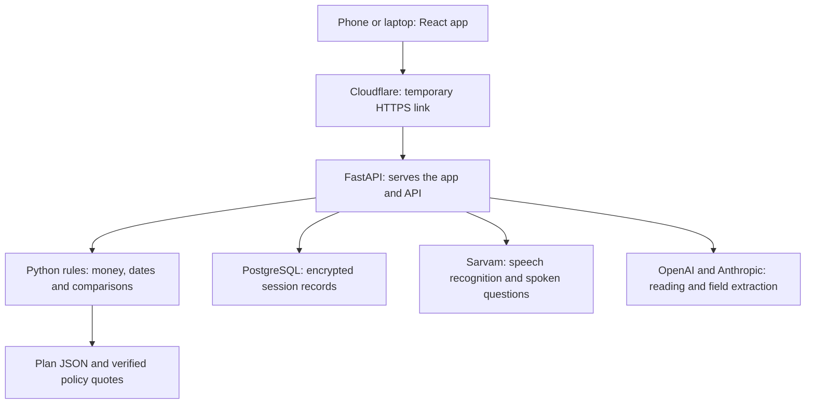

# PakkaCover

PakkaCover helps families explain their health details in simple language.
It turns confirmed answers and sample policy terms into a clear cover timeline.
It checks a policy document for differences and saves the next steps.

**[Open the working demo](https://camping-leon-rider-performer.trycloudflare.com)** · [Three-minute video script](VIDEO-SCRIPT.md) · [Demo guide](DEMO.md)

The demo runs on the owner's Mac through a temporary HTTPS tunnel. The Mac and tunnel must stay online. A tunnel restart can change the link.

## The problem

Buying health insurance can leave a family with important questions:

- Did we share all the right medical details?
- When does cover for an existing illness begin?
- Why would two plans pay different amounts for the same example claim?
- Does the policy document include the cover we expected?
- What should we do if something is missing?

Long forms and policy documents can make these questions hard to answer. PakkaCover brings the answers into one guided journey.

## What PakkaCover does

The demo follows **Sunita, age 52, who has high blood pressure**. She can speak in Hindi or English, use answer buttons, or type.

| Step | What happens |
| --- | --- |
| **Talk** | Answer one question at a time. The health form fills as the answers arrive. Upload a printed medicine label for two separate AI readings. |
| **Check** | Confirm every answer individually. Correct a wrong answer before moving on. |
| **Compare** | View three sample plans, example payouts and waiting-period timelines on the same scale. Tap a reason to read its source clause. |
| **Promise Card** | See the important cover dates, the free-look action deadline and upcoming reminders. Add the dates to a calendar. |
| **Demo payment** | Choose UPI, Wallet or Card in a clearly labelled ₹1 simulation. See a success screen and a saved notification. |
| **Policy check** | Upload a policy PDF and compare its fields with the confirmed details and selected sample plan. See both statements when a difference is found. |
| **Finish review** | Save the review and its next steps. Any unresolved difference stays visible on the completion screen. |

The menu's **Reset demo** starts an empty interview at question one. It clears that session's health details, orders and notifications. It keeps the browser's purpose-consent choices and the app-wide spending counters. Member agreement is requested again.

## Why this approach helps

- **Start with a conversation.** Voice, buttons and typing give people different ways to answer.
- **Let the person check the record.** Every declaration line needs its own confirmation.
- **Ask when unsure.** A blurry label or a reader disagreement leads to a question. The person chooses what the medicine is used for.
- **Show the reason.** Calculated cover dates and payouts link back to verified policy quotes.
- **Check the final document.** The policy audit can highlight a missing add-on, a missing declared illness or incorrect member details.
- **Keep the next action clear.** The user can view a correction-request draft, read cancellation guidance or record an advisor callback request.

These features aim to make mistakes easier to spot and insurance terms easier to understand. They do not guarantee that an insurer will accept a proposal or pay a claim.

## How it works

AI helps turn speech, printed labels and policy text into structured information. The user checks the answers. Python rules calculate the money, dates, ranking and differences.

For example, the rules engine checks which waiting periods apply to a claim. It calculates an example payout and attaches the policy clause used for that result. A number extracted by AI must be supported by the input; unsupported numbers are rejected.

Plans A, B and C use selected terms from public policy wordings. The comparison uses the same independent example claims across the plans. The amounts are educational examples, not premiums, forecasts or payment guarantees. Read the [comparison method](docs/method.md) for the assumptions and calculations.

## Architecture

The current demo has one web app, one backend and one PostgreSQL database.



| Part | Technology | Job |
| --- | --- | --- |
| Screens | React, TypeScript, Vite and plain CSS | Hindi/English interface, microphone, camera, cards and timelines. |
| Backend | FastAPI and Python 3.12 | Sessions, consent, interview steps, confirmations, uploads, payments and saved reviews. |
| Rules engine | Python, Decimal and calendar arithmetic | Repeatable calculations for payouts, cover dates and comparisons. |
| Database | PostgreSQL, SQLAlchemy, asyncpg and Alembic | Store records, enforce session ownership and manage database changes. |
| Health-data encryption | Fernet | Encrypt health fields before storing them in the database. |
| Speech | Sarvam REST API | Convert speech to text and read questions aloud. |
| AI readers | OpenAI and Anthropic | Read medicine labels and extract fields with supporting source text. |
| Public access | Cloudflare quick tunnel | Give the local app an HTTPS address for phone microphone/camera access. |

FastAPI serves the built React files and `/api/*` routes from the same address. API keys stay on the server.

## Run locally

The launcher is built for the **macOS hackathon demo**. Have Homebrew, Python 3.12, Node.js and npm available.

```sh
git clone https://github.com/Baharul0111/pakkacover.git
cd pakkacover
```

Create a private `.env` file in the project folder and fill in these settings:

| Setting | Purpose |
| --- | --- |
| `ANTHROPIC_API_KEY` | Answer extraction, a medicine reader and policy-document extraction. |
| `OPENAI_API_KEY` | The other medicine reader, extraction fallback and moderation. |
| `SARVAM_API_KEY` | Speech recognition and spoken questions. |
| `SARVAM_BALANCE_INR` | Starting speech balance used by the app's spending guard. |
| `DATABASE_URL` | PostgreSQL connection. Leave empty to let the launcher prepare local PostgreSQL. |

Then run:

```sh
scripts/run_demo
```

The command prepares dependencies and the local database, applies migrations, builds the web app and starts the API and HTTPS tunnel. It prints the phone URL and saves it as `PUBLIC_URL` in `.env`.

The app generates its encryption keys and `DEMO_LOGIN_PASSPHRASE` when they are missing. Saving uses that private demo passphrase. Local `.env` values take precedence over unrelated keys inherited from the shell. Keep `.env` private; it is excluded from Git.

Useful commands:

```sh
scripts/run_demo --status       # Check the running demo
scripts/run_demo --restart-api  # Restart the API and keep the tunnel
scripts/run_demo --retunnel     # Replace the tunnel and print a new URL
scripts/run_demo --stop         # Stop the API and tunnel; keep local PostgreSQL
```

The local laptop address is `http://127.0.0.1:8000`. Use the HTTPS URL on a phone.

## Try the policy audit

For the supplied example, use **Plan B, female, age 52, hypertension, policy start 31 October 2026**.

- [Missing-add-on PDF](demo-files/PakkaCover-Sunita-Plan-B-Missing-Addon.pdf): shows the missing Instant Cover flag and follow-up actions.
- [Clean PDF](demo-files/PakkaCover-Sunita-Plan-B-Clean.pdf): shows a matching policy result.

Both PDFs are clearly labelled fictional demo documents. [Sample instructions](demo-files/README.md) explain how to use them.

With a flagged result, acknowledge that you have reviewed the differences, then choose **Finish review**. Finishing saves the review; it does not accept a policy or mark the differences fixed.

## Tests and verification

With the local database running:

```sh
.venv/bin/python -m pytest -q
.venv/bin/python scripts/check_quotes.py
npm --prefix apps/web run build
```

The frozen build has **150 passing Python tests** and **44 verified policy-clause references**. Checks cover calculations, source quotes, session isolation, individual confirmation, numeric safeguards, planted policy mismatches, demo payments, reset and review completion.

The base journey completed three full HTTPS browser rehearsals. The finishing-step revision has additional local and HTTPS browser checks for acknowledgment, saved results, reload and reset. Detailed evidence is in [the verification record](evals/results/freeze-verification.json).

Policy-source PDFs are not committed. For quote checks on a fresh checkout, place the pinned documents in `data/plans/src/` using the filenames, URLs and expected hashes in [sources.json](data/plans/sources.json). The quote checker validates the source files and quoted text.

## Privacy and fallbacks

Each browser has its own session. Backend queries check session ownership, and health fields are encrypted in PostgreSQL. The app processes uploaded audio, photos and PDFs in memory and does not keep the raw uploads. The downloadable demo PDFs contain fictional data.

External providers receive the inputs needed for speech or reading, as explained on the consent screen. Their own data policies apply.

Voice can be switched off while buttons and typing remain available. Failed readings ask for clarification or manual entry. Generated policy samples also have a source-checked fallback parser. Operator switches and app-side spending limits control outside calls. See [the demo guide](DEMO.md) for recovery commands.

## Current scope

This is an educational hackathon demo. The Sunita path is the complete demonstration; other interview branches may use manual fallbacks.

**Paytm payment is a demo screen; PG test keys could not be obtained.** No real money moves, no Paytm gateway is called and no provider verification is claimed.

Correction and cancellation actions provide a draft or guidance. Advisor requests are saved for the demo operator; no licensed advisor partner is connected. Production hosting, real identity, real payments, retention tools and a wider plan catalogue are future work. Browser checks cover phone/laptop layouts; real-user media and physical-phone hardware validation remain separate work.

Current frozen application: **`demo-3`**. Earlier **`demo-1`** and **`demo-2`** tags are preserved.

## Project guide

| Location | Contents |
| --- | --- |
| [`apps/web`](apps/web) | React interface and browser checks. |
| [`apps/api/app`](apps/api/app) | FastAPI backend, interview, readers, payments and audit. |
| [`apps/api/app/engine`](apps/api/app/engine) | Calculation and comparison rules. |
| [`data/plans`](data/plans) | Sample plan rules, source details and clause references. |
| [`data/drugs`](data/drugs) | Demo medicine names and reference tables. |
| [`migrations`](migrations) | Database migrations. |
| [`tests`](tests) | Python tests. |
| [`scripts`](scripts) | Launcher, checks and operator helpers. |
| [`DEMO.md`](DEMO.md) | Stage walkthrough, private-login location and recovery. |
| [`VIDEO-SCRIPT.md`](VIDEO-SCRIPT.md) | Three-minute English narration. |
| [`TRACKING.md`](TRACKING.md) | Current state and implementation history. |
| [`HACKATHON.md`](HACKATHON.md) | Demo-specific choices and limitations. |
