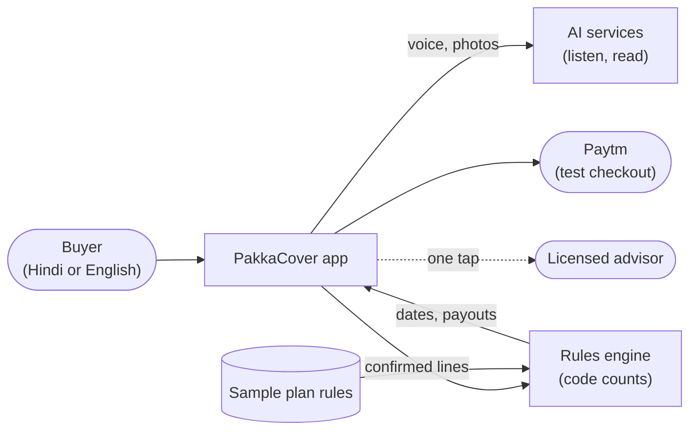
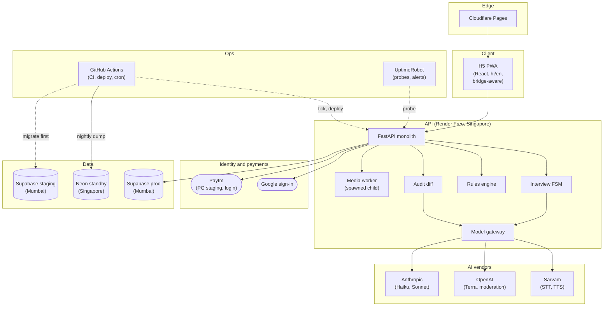
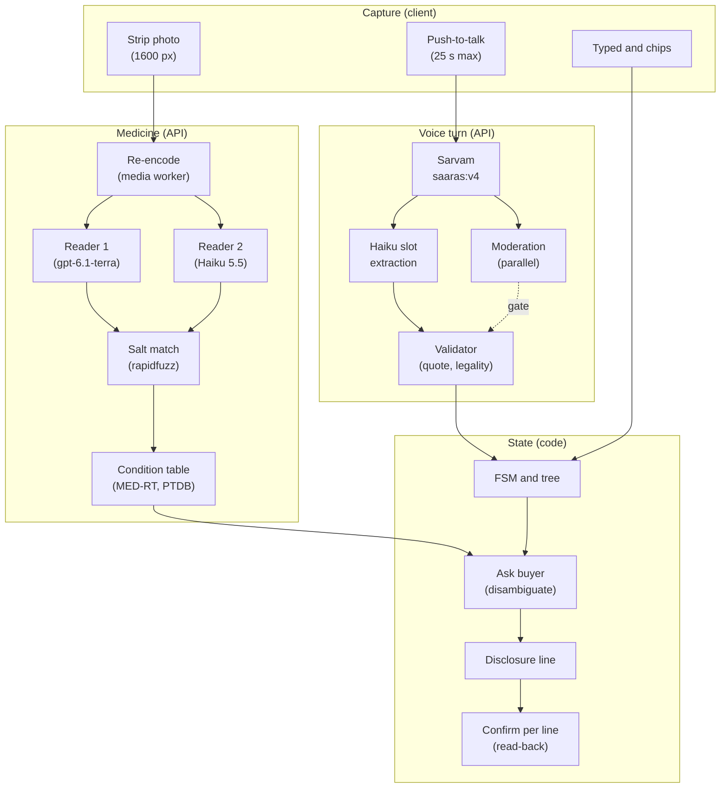
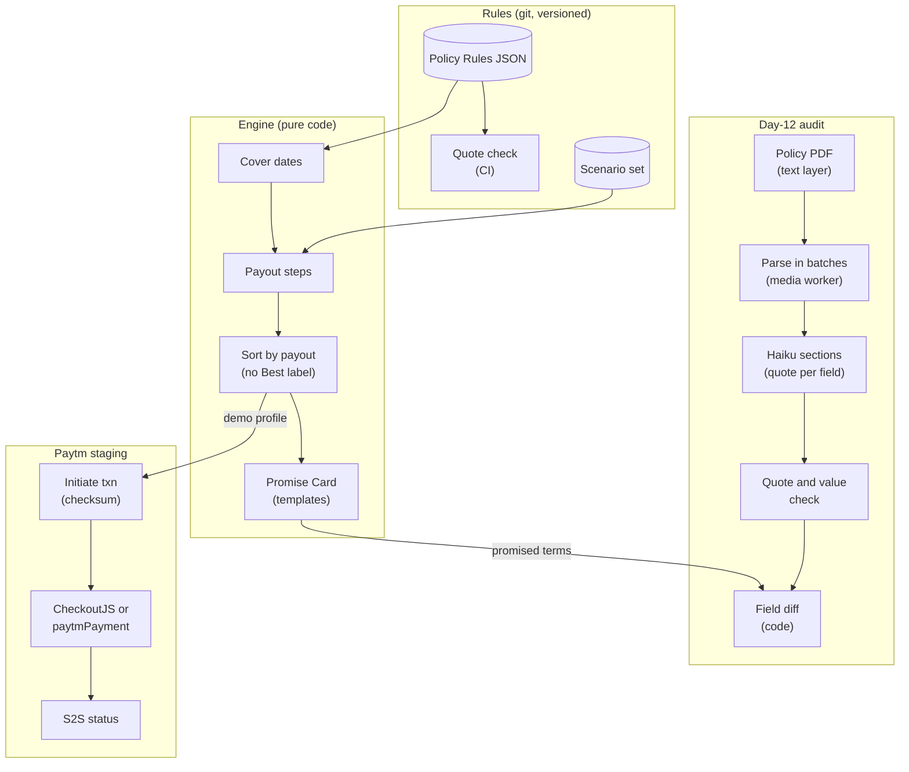
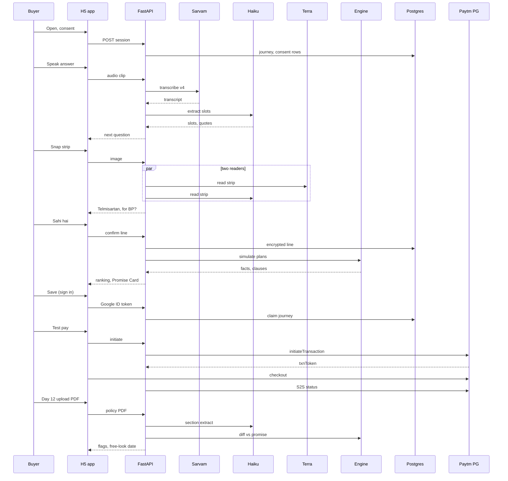
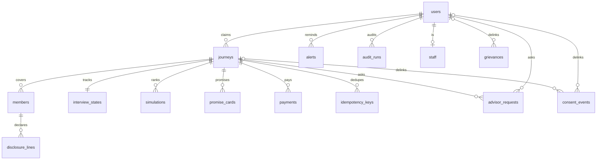

# PakkaCover — Architecture
> Approved by Baharul Islam on 2026-10-29. Built by the Fuller pipeline. Do not deviate without updating this file.

This file is the single source of truth for how PakkaCover is built. It is self-contained: everything needed to build, deploy, test and run the product is here. Where a fact could not be confirmed from a primary source it is marked **[unverified]** or **[verify]**, together with the fail-safe default to use until it is settled.

Conventions used throughout:
- Rupee figures use US$1 = ₹88 **[unverified]**; recompute at build time.
- "★★" = must be done before the demo deploy slot (30 Oct 2026, 19:00 IST). "★" = must be done before the first real user.
- `E` on a column means it is MultiFernet-encrypted. All primary keys are ULIDs.
- Hindi strings are written in Roman script here; the UI shows them in Devanagari (Hindi mode) or Roman (Hinglish), with an English translation in brackets in this file.

---

## What this system is

PakkaCover is a helper that sits inside the moment a family buys health insurance on Paytm. The buyer talks to it in Hindi, English or a mix of both for about three minutes, and photographs the medicine strips the family takes. It turns that conversation into an honest health declaration, written the way an insurer's proposal form asks for it, and the buyer checks and approves every single line; nothing is ever sent anywhere on its own. It then shows how a few real sample plans would actually pay out for this family's likely claims, with every rupee and date tied to the exact sentence in the policy wording, and no plan labelled "best". It gives the buyer a one-screen "Claim Promise Card" that says what is covered from which exact date, and reminds them as those dates arrive. Around day 12 after the policy arrives, it reads the issued policy document and points out anything that does not match what was declared and promised, while there is still time in the 30-day free-look window to get it fixed or cancel for free. The AI only listens, reads and phrases questions; plain, tested code does every calculation of money and dates, and a licensed human advisor is always one tap away.

---

## Requirements & constraints

### Source requirements

PakkaCover comes from Team Solidary's pitch for the Paytm Build for India AI Hackathon, Track 2 (AI-Powered Financial Journeys). The premise: about 68% of rejected Indian health-insurance claims trace back to purchase day (non-disclosure 25%, didn't know what was covered 25%, claimed inside a waiting period 18%; Policybazaar analysis, cite as "Policybazaar analysis (Nov 2023)"; the "30,000 rejections, Apr–Sep 2023" figure is not confirmed).

The four product steps:
1. **Talk, don't type: voice disclosure.** A ~3-minute voice chat in Hindi/English. The buyer photographs medicine strips. A vision model reads the medicine (e.g. "Telmisartan 40 mg"); a drug table maps medicine → condition; if unsure, the system asks and never guesses. The result is an honest disclosure in proposal-form wording. The buyer confirms every line ("Sahi hai, confirm karein"). Nothing is auto-submitted.
2. **Rank by payout, not price.** Plans are sorted by what each would actually pay for this family's likely claims. Every number links to its policy clause.
3. **Claim Promise Card.** One screen: what is covered from which exact date (accidents now, most illnesses from day 31, pre-existing diseases (PED) per plan, specific-disease waits, permanent exclusions). Date alerts. Hindi/English.
4. **Day-12 free-look audit.** AI reads the issued policy PDF and diffs it against the confirmed disclosure and the promised terms, so errors are fixed or the policy cancelled free before day 30 (IRDAI 2024 free-look = 30 days).

**Core principle: "AI reads and talks. Code does the counting."** No model ever decides a rupee or a date. A deterministic rules engine over a clause-quoted Policy Rules JSON computes waiting-period dates, caps, room-rent limits, co-pay, sub-limits and payout. A human confirms every disclosure line. A licensed advisor is one tap away. The product says honestly when disclosure can raise the premium.

**Finals demo:** 31 Oct 2026, Bengaluru. Script: Sunita (52, hypertension) buys in about 4 minutes: speaks Hindi, snaps a BP strip, the disclosure builds itself, 3 real-format plans ranked by payout, a Promise Card with exact dates, and the audit catches a planted mismatch.

**Builder:** Baharul Islam, solo (Team Solidary), building with Claude Code. Dev machine: Windows laptop, RTX A2000 4 GB, 24 GB RAM (nothing runs locally in production).

### Interview answers (binding)

| # | Topic | Answer |
|---|---|---|
| 1 | Scale | 30–50 users initially. Document the growth path to Paytm scale; do not build it now |
| 2 | Demo vs production | Real production for real users **and** the hackathon demo. Ultra-deep design |
| 3 | Where it runs | Free cloud tiers only (₹0/month infrastructure) |
| 4 | AI models | The user's own OpenAI and Anthropic keys for all LLM/vision. Everything else free. Speech: free if available and good |
| 5 | Languages | English and Hindi now, with Hinglish code-mixing. More later |
| 6 | Insurer plans | No insurer documents or partnerships. Build Policy Rules from public wordings/brochures/CIS of real Indian retail plans, labelled as sample data |
| 7 | Paytm | Use real Paytm as far as an individual developer can; anything the user must do goes into setup.md; be honest about what cannot be obtained |
| 8 | Data rules | Health data (sensitive personal data), India. DPDP Act 2023 + DPDP Rules 2025; IRDAI rules on intermediaries/advice (PakkaCover is not a licensed broker: sample plans, human advisor, disclaimers). DB in an India region where the free tier allows |

### Recorded assumptions

From the requirements interview:
- Time-to-demo dominates: a demo-complete build must exist by the night of 30 Oct; production hardening follows before any real user.
- Mobile-first web app (H5) that runs standalone **and** inside the Paytm Mini App container.
- The policy purchase cannot be real (no broker licence, no insurer API). Checkout is Paytm PG **staging** (test money), labelled. The issued policy for the audit is a generated sample PDF, or a real policy PDF the user already owns.
- Budget: ₹0/month infrastructure; AI and speech usage on the user's keys, target ~₹3–5 per buyer.
- Auth must be free in India. SMS OTP costs money and is not used.
- Alerts use free channels only (in-app, calendar file; email only if a domain is added). No SMS or WhatsApp.

Taken on the user's behalf during design (the user required ₹0 and the free default was chosen each time):
- **No paid domain.** Standalone sign-in is Google sign-in; inside Paytm, Paytm login. Alerts are in-app plus a downloadable `.ics` calendar file. Email OTP and email alerts are built but switched off; an optional domain (~₹100–900/year) turns them on.
- **The builder holds the key escrow** (Bitwarden plus an offline copy in a second place). A second holder is optional.
- **Private GitHub repo** (scheduled workflows don't auto-disable; insurer wordings and security posture stay unpublished).
- **No healthcare exemption is claimed** under the DPDP Fourth Schedule. Minors are handled by parent/guardian attestation, with Rule 10 "verifiable" consent recorded as a known gap until about May 2027.

Resolved while writing this pack (consistent with the approved design):
- **Anonymous-data notice says "within 48 hours".** The anonymous purge runs in the daily tick and erases journeys idle more than 24 h, so the true bound is 24–48 h (R3-m6a; the alternative, an hourly in-process purge, was not chosen).
- **CSP mode is part of the runtime profile, applied at front-end build time.** The `_headers` file is generated from the active profile when Cloudflare Pages builds (see "Runtime profiles").
- **The Sarvam cap-size assertion is per profile**: each profile's daily Sarvam cap must be at least 4 × that profile's per-journey Sarvam cost (demo ≈ ₹3 → ≥ ₹12; pilot ≈ ₹1.9 → ≥ ₹7.6).
- **CSP rollout for the pilot**: Report-Only with a `report-to` endpoint for the first 3 pilot days, then enforced. The pilot-open checklist asserts the Report-Only header and the report endpoint at open, and an "enforced" check runs on pilot day 3. The report endpoint writes to a small content-free `csp_reports` table (aggregated directive + blocked-host counts, kept 90 days).
- **De-linked `consent_events` are purged after 1 year by `pc_purge`** (the retention table keeps them 1 year; the role grant to do so is added here).
- **Demo profile ends by 1 Nov 23:59 IST**: the `pilot` profile is applied then with `pilot_open=false`, so the `DEMO_PROFILE_LIVE` alarm never fires during phase 2; `pilot_open=true` is the last step of the pilot-open checklist.

### Hard constraints, summarised

- ₹0 infrastructure. Free tiers: Cloudflare Pages, Render Free, Supabase Free (×2), Neon Free, GitHub Actions (private repo), UptimeRobot Free, Google sign-in.
- AI spend only on the user's OpenAI/Anthropic keys; Sarvam within its ₹100 free credit (paid boundary stated honestly).
- 30–50 users, one solo operator, alerts 08:00–23:00 IST.
- Database in India (Supabase Mumbai). Compute (Render Singapore) and inference (US) are outside India, disclosed and consented.
- No sale, no premiums, no "best/top/recommended" labels, no insurer logos.
- Nothing is ever submitted to an insurer by the system.

### Requirement trace

| Requirement | Design element |
|---|---|
| Voice disclosure, Hindi/English, ~3 min | Push-to-talk turns ≤ 25 s → Sarvam STT → Haiku slot extraction → explicit state machine over the tele-MER question tree |
| Photograph strips; never guess | Two parallel transcribe-only readers; salt-first curated tables; disagreement or more than one candidate condition → buyer chooses; 0% auto-assignment |
| Proposal-form wording; confirm every line; nothing auto-submitted | `disclosure_lines.confirmed` is set only by `POST /v1/lines/{id}/confirm`; one card per line; read-back; no submit endpoint exists |
| Rank by payout; every number links to a clause | Engine `simulate()` over a published scenario set; every number is a `Fact(value, rule_id, clause_ref)`; tap shows the verbatim quote |
| Promise Card with exact dates, alerts, hi/en | Engine-only dated rows; hi/en templates; in-app card + `.ics` (email only with optional domain) |
| Day-12 audit; fix or cancel before day 30 | Section-wise quote-verified extraction → deterministic diff → flags with both quotes and the free-look deadline |
| "AI reads and talks, code does the counting" | Counting zone has no model; numeric guard on the only LLM-phrased text; templates for every explanation |
| Licensed advisor one tap away | "Advisor se baat karein" on every screen → `advisor_requests` with a prepared brief; named partner or "pilot callback within 24 h" label, never a dead button |
| Honest about premium impact | "Add-on required" flags with clause + the loading/premium disclosure line; no rupee premiums |
| Roadmap: term life, claim help, loan KFS | Engine and schema carry `product_type`; audit pipeline is reusable |
| 30–50 users; growth path | Sized for 50; 10× and Paytm-scale path in "Scaling plan & cost" |
| Free tiers | See the free-quota budget (Actions ≈ 1,340 of ~2,000 private minutes/month) |
| English, Hindi, Hinglish | `language_code=unknown` STT; hi/en templates; `_enhi_` voice for mixed lines |
| Real plans, labelled sample | Care Supreme + Instant Cover, HDFC ERGO my:Optima Secure, Tata AIG MediCare Premier; "Sample terms from public policy wording — education only" banner |
| Real Paytm | PG staging (real APIs, test money); bridge-aware H5; Paytm consent login coded to the docs; DIY Mini App steps in setup.md |
| DPDP, IRDAI, India region | Per-purpose consent, itemised notice, erasure, breach runbook, Rule 8(3) logs; no Best labels/premiums/sale; DB in Mumbai |
| Mobile-first, standalone + inside Paytm | One React/Vite build; `bridge.ts` detection with fallbacks |
| ₹0 infra; ~₹3–5 per buyer | ₹0 infra; ≈ ₹3.3 per buyer typical, ≈ ₹4.4 demo profile, ≈ ₹13.6 worst case |
| Free auth; no SMS | Paytm consent login inside; Google sign-in outside; email OTP optional with a domain |

---

## Architecture

### Level 1 — The simple view



- The buyer only ever talks to the app.
- The app sends voice and photos to AI services, which only listen and read.
- Only lines the buyer has confirmed reach the rules engine, which works out every date and rupee from the sample plan rules.
- Payment is a clearly labelled Paytm test checkout. A licensed advisor is one tap away on every screen.

### Level 2 — Detailed technical architecture



- **Client:** one React/Vite PWA served by Cloudflare Pages. It detects the Paytm JSBridge at runtime and uses Paytm login, camera and payment inside the container; web equivalents outside.
- **API:** one FastAPI process on Render Free (0.1 CPU / 512 MB). Inside it: the interview state machine, the pure-Python rules engine, the audit diff and the model gateway. All CPU-heavy image and PDF work runs in one **spawned media worker** child process.
- **AI vendors** are reached only through the gateway, with explicit timeouts and a logged model id per call.
- **Identity:** Google sign-in (standalone) or Paytm consent login (inside Paytm), verified server-side. **Payments:** Paytm PG staging (test money).
- **Data:** Supabase prod (Mumbai) is reached server-side only, with its Data API turned off. A second free Supabase project is staging (migrations, evals, role test). Neon Singapore is the nightly-restored standby.
- **Ops:** GitHub Actions (private repo) runs CI, the migrate-then-deploy job, the daily tick and the nightly encrypted backup (which also restores into Neon). UptimeRobot probes `/ready` every 5 min (which also keeps Render and Supabase awake) and watches the alarms endpoint.

### Level 3 — The super deep architecture

#### Level 3a — Disclosure path



- A voice clip is transcribed by Sarvam; moderation runs in parallel with the Haiku slot extraction; the validator checks that every slot's quote is in the transcript and legal for the current question before the state machine accepts it. Typed answers and chips go straight to the state machine.
- A strip photo is re-encoded (EXIF stripped) in the media worker, then read by two models in parallel. Their salt text is fuzzy-matched to a curated generic table; the generic's possible conditions come from a curated offline table. Any disagreement or more than one candidate condition becomes a question to the buyer.
- Every resulting line is shown as its own card, high-impact lines are read back aloud, and only the buyer's tap confirms it.

#### Level 3b — Compute, audit and pay



- Policy Rules JSON lives in git; CI checks every clause quote against the source PDF's text. The engine derives cover dates, then runs each scenario claim through the payout steps, sorts plans by total modelled payout and fills the Promise Card templates.
- The audit parses the PDF in page batches inside the media worker, extracts each section with Haiku (every field carries a page and verbatim quote), verifies quote and value in code, and diffs against the confirmed disclosure and the promised terms.
- The ₹1.00 TEST checkout runs only under the `demo` profile; pilot users end at the advisor handoff.

### Key design decisions

| Decision | One-line reason |
|---|---|
| One static PWA + one FastAPI monolith + one Postgres | Smallest thing that serves 50 users on free tiers; stateless API scales by config later |
| Explicit state machine, not an agent framework | Confirm-every-line must be an HTTP transition; LangGraph's replay-before-`interrupt()` is a correctness hazard; ~250 LOC and unit-testable |
| No model in the counting zone; hand-written hi/en templates for all explanations | Makes LLM-invented rupees/dates impossible by construction |
| Primary STT `saaras:v4` with `keyterms`; alternate `saaras:v3` + `mode=codemix` | `keyterms` is v4-only and `codemix` is v3-only (verified); medicine names are the costliest errors; day-1 A/B decides |
| STT failure falls back to typed + chips, never silently to another model | No Hindi WER exists for `gpt-transcribe`; it is promoted only through a measured gate |
| Two parallel strip readers; the buyer breaks ties | ~₹0.05 extra, no added latency, free agreement signal; no Opus tiebreak (fabrication risk, latency) |
| Audit: Haiku per section, quote + value-in-quote check, one Sonnet retry, else "check manually" | Cheap, grounded, and section-wise extraction is forced by structured-output limits anyway |
| Salt-first medicine matching against curated tables; offline condition snapshot | Avoids SNOMED/UMLS licence exposure and unread CDCI licence on the demo path |
| Anonymous until Save / Alerts / Audit | IRDAI dark-pattern guidance and Paytm's own deferred-login flow |
| No rupee premiums; "add-on required" flags | No premium data in public wordings; premiums push toward solicitation |
| ₹1.00 TEST order on real Paytm PG staging (demo only) | Real APIs exercised; no licence to sell; pilot users never see a payment |
| Credentials (`auth_tokens`) separate from data roots (`journeys`, `users`); one opaque token type, no JWTs or refresh tokens | Logout/expiry/revoke can never delete data; instant revocation |
| `erase_subject()` is the only code path that deletes person data | One tested path for every DPDP erasure trigger |
| Grants-only least-privilege DB roles, Data API off, no RLS | With the Data API off RLS protects nothing, and policy-less RLS would block the app and `pg_dump` |
| Per-purpose consent (P1–P4) + per-member attestation | DPDP notice needs itemised data per specified purpose; family members are Data Principals |
| Runtime profiles `demo` / `pilot` as the single source of demo-vs-pilot configuration | Prevents demo conveniences (demo login, echo route, loose caps) leaking into the pilot |
| Scratch scaffold, not a template fork | Stripping a fork costs as much as it saves on a 2-day clock |

### Components and stack

| Layer | Choice | Link / reason |
|---|---|---|
| Front end | React 19 + Vite + TypeScript PWA (`vite-plugin-pwa`, `registerType:'autoUpdate'` + skipWaiting), Tailwind + shadcn/ui components copied in, `react-i18next` (hi/en), mobile-first, large tap targets | https://github.com/vite-pwa/vite-plugin-pwa. Voice plus graphics gives the best task completion for low-literacy users (Medhi et al.) |
| Paytm adapter | `apps/web/src/paytm/bridge.ts`: `JSBridgeReady` wait (≤ 1 s), `call()` wrapper with promise + timeout, `fetchAuthCode`, `captureImage` with `paytmCheckPermission`/`paytmRequestPermission`, `pay`, `popWindow` | https://www.paytmpayments.com/docs/miniapps/guidelines (verified) |
| Static hosting | Cloudflare Pages Free; `public/_headers` generated from the active profile at build | https://developers.cloudflare.com/pages/platform/limits/ (verified). Vercel Hobby is non-commercial |
| API | Python 3.12, FastAPI, Pydantic v2, SQLAlchemy 2 (async, asyncpg), Alembic, httpx, structlog, slowapi, `cryptography` (MultiFernet), rapidfuzz, python-dateutil, pdfplumber + pypdf + pypdfium2 (audit), reportlab (sample PDF generator), Pillow (image re-encode / EXIF strip), `python-ulid`, `pyotp` (staff TOTP), `google-auth` (ID-token verify). **All PDF and image work runs in the spawned media worker** | Render Free is **0.1 CPU / 512 MB** (verified https://render.com/docs/compute-plans), so CPU-bound work never runs on the event loop. **Do not use** PyMuPDF (AGPL), marker (weights licence), unstructured (telemetry), LlamaParse (sends PDFs abroad) |
| AI SDKs | `anthropic` (`messages.parse` with Pydantic models), `openai` (Responses API, `store=false`), raw httpx to Sarvam (its SDK licence is undeclared) | https://platform.claude.com/docs/en/build-with-claude/structured-outputs (verified). No Instructor: native structured outputs suffice |
| API hosting | Render Free, Singapore, Docker, 1 instance, dedicated workspace, auto-deploy **off**; kept warm by UptimeRobot `/ready` every 5 min | https://render.com/docs/free (verified) |
| Database | Supabase Free, Mumbai `ap-south-1`, plain Postgres (version recorded at setup; new projects default to Postgres 17). API connects through the **Supavisor pooler in session mode (port 5432)**, SQLAlchemy `pool_size=5, max_overflow=2, pool_pre_ping=True, pool_recycle=300`, asyncpg `statement_cache_size=0`. All tables in schema **`app`**. **Data API off**. `anon`/`authenticated`/`PUBLIC` revoked. Grants-only least-privilege roles, **no RLS**. Extension `pg_trgm` | https://supabase.com/pricing (verified) · https://supabase.com/docs/guides/api/securing-your-api (verified: "With the Data API disabled, none of the auto-generated REST endpoints respond") |
| Staging DB | Second free Supabase project, Mumbai, same `infra/supabase.sql` | 2 free projects allowed (verified) |
| Standby + backups | Neon Free (Singapore, same Postgres major as Supabase), restored nightly; **7 daily `age`-encrypted dump generations** as private-repo Actions artifacts, `retention-days: 7` | https://neon.com/pricing (verified). Artifact storage on GitHub Free is 500 MB, shared with Packages (verified); dumps are < 20 MB each |
| Keep-alive + alerting | **UptimeRobot Free**: 50 monitors, 5-min interval, keyword monitors, no card; allowed for "personal and commercial projects" (verified). Monitors: prod `/ready`, `/internal/alarms/<token>` keyword monitor, staging `/ready-staging/<token>` | https://uptimerobot.com/pricing/ (verified). Alerts by email to the builder's phone-notified inbox (guaranteed); mobile-app push on Free **[verify]** |
| Scheduler + CI/CD | GitHub Actions in a **private** repo: `ci.yml`, `deploy.yml`, `tick.yml` (daily 09:00 IST), `backup.yml` (nightly 02:30 IST). ≈ 1,340 of ~2,000 private minutes/month, alert at 75% | Public repos auto-disable scheduled workflows after 60 days of inactivity (verified https://docs.github.com/en/actions/managing-workflow-runs-and-deployments/managing-workflow-runs/disabling-and-enabling-a-workflow) |
| Sign-in | Inside Paytm: Paytm consent login. Standalone: **Google Identity Services**, ID token verified server-side. Email OTP optional, only with a domain | Free, no domain needed |
| Email (optional, off) | Resend Free HTTP API, only with an owned verified domain (SPF + DKIM + DMARC) | https://resend.com/pricing (verified). `resend.dev` sender can only email the account owner; Render blocks SMTP |
| Payments | Paytm PG staging: Initiate Transaction + CheckoutJS / `paytmPayment` + S2S status; `paytmchecksum` vendored + `pycryptodome` pinned | https://www.paytmpayments.com/docs/getting-started (verified) · https://github.com/paytm/paytm-agent-skills (verified, MIT) |
| Dev tooling | Claude Code + paytm-agent-skills (`npx paytm-agent-skills install` before any payment code); pytest + Hypothesis; promptfoo (phase 2); ruff with the `S` (bandit) rules incl. `S608`; `uv.lock` + `package-lock.json` committed; Dependabot (pip, npm, docker) weekly; `pip-audit` + `npm audit --omit=dev` in CI; base image pinned by digest, rebuilt monthly; locust (phase 2); OWASP ZAP baseline (phase 2) | https://github.com/promptfoo/promptfoo |

### Repository layout

```
pakkacover/                      (PRIVATE repo)
  apps/web/                      React H5 (src/paytm/bridge.ts, src/i18n/, public/_headers generated at build)
  apps/api/                      FastAPI
    app/routes/                  HTTP routes, all under /v1 (plus /health, /ready, /internal/*)
    app/repo.py                  owner-scoped data access (the only way routes touch person data)
    app/repo_staff.py            staff reads, always writes access_log
    app/fsm/                     interview state machine + tree loader
    app/engine/                  pure rules engine (dates, payout, ranking, promise card facts)
    app/audit/                   audit locate/extract/verify/diff
    app/medicine/                strip readers, salt matching, condition lookup
    app/gateway.py               model gateway (reads models.yaml; timeouts; decision_events)
    app/paytm/                   PG staging + auth client (checksum vendored)
    app/privacy/erase.py         erase_subject(): the only data-delete path
    app/privacy/housekeeping.py  allowlisted non-person deletes (auth_tokens, idempotency_keys, otp_codes, csp_reports, 1-year log purge)
    app/templates/               hi/en templates for every explanation
    app/jobs/                    tick: purges, alerts, payments reconcile, synthetic probe, auto-pause
    app/media_worker.py          minimal child module: Pillow, pypdf, pdfplumber, pypdfium2 only
    app/net.py                   client_ip() (trusted hop)
    models.yaml                  pinned model ids + ladders
  data/plans/*.json              Policy Rules (one per plan)
  data/plans/sources.json        wording URL + SHA-256 per source doc (PDFs are NOT in git; CI downloads and verifies)
  data/scenarios.json            published scenario set (versioned)
  data/drugs/*.csv               generics.csv, brand_aliases.csv, generic_conditions.csv (versioned)
  data/tree/disclosure_tree.json question tree (tree@semver)
  infra/render.yaml              Docker web service; plain uvicorn start; no preDeployCommand
  infra/supabase.sql             idempotent: schema, roles, grants, default privileges, revokes
  infra/wrangler.toml
  infra/profiles/demo.json       runtime profile (single source of demo config)
  infra/profiles/pilot.json      runtime profile (single source of pilot config)
  docs/breach-runbook.md  docs/runbooks/*.md  docs/privacy-policy.md
  docs/security-practices.md  docs/method.md  docs/dpa/
  evals/golden/  evals/results/  evals/run.py
  scripts/sample_policy.py  scripts/check_quotes.py  scripts/build_drug_tables.py
  scripts/backup.sh  scripts/restore_drill.sh  scripts/support.py
  scripts/set_profile.py  scripts/gen_headers.py  scripts/purge_override.py
  .github/workflows/ci.yml  deploy.yml  tick.yml  backup.yml
  setup.md
```

### Runtime profiles: `demo` and `pilot` (single source of truth)

All demo-versus-pilot behaviour comes from one named profile. There is **no `DEMO_MODE` or `PAYMENTS_MODE` environment variable**; code reads the profile values from `config_flags`. (R3-M1, R3-M2; ★★ items 1–3, ★ items 4–5.)

| Key | `demo` profile | `pilot` profile |
|---|---|---|
| `profile` | `demo` | `pilot` |
| `payments_mode` | `staging_demo` (₹1.00 TEST order) | `off` (ends at advisor handoff) |
| `tts_scope` | `all` (every question spoken) | `readback` (high-impact lines only) |
| `session_create_per_ip_hour` | 50 (venue Wi-Fi) | 10 |
| `session_create_global_per_day` | 100 | 100 |
| `sarvam_daily_budget_inr` | **40** | **10** |
| `global_daily_spend_inr` | **150** | **60** |
| `demo_login_enabled` | true (passphrase-only, see Auth) | false (route returns 404) |
| `debug_echo_enabled` | true until `TRUSTED_HOPS` is recorded, then false | false (route not registered) |
| `csp_mode` | `report_only` (enforce only if G8 ran clean with it enforced) | `report_only` + `report-to` for the first 3 pilot days, then `enforce` |

How it works:
- `infra/profiles/{demo,pilot}.json` hold the values above. `scripts/set_profile.py <name>` writes them into `config_flags` and writes an `access_log` row. It is the only supported way to switch.
- `csp_mode` is applied by `scripts/gen_headers.py`, which runs in the Cloudflare Pages build (env `PAGES_PROFILE=demo|pilot`) and writes `apps/web/public/_headers`.
- `pilot_open` (`config_flags`, default false) is set to true by the pilot-open step.
- `/ready` returns `{status, profile, build_id}` where `build_id` = Render's `RENDER_GIT_COMMIT`.
- Alarm `DEMO_PROFILE_LIVE` fires if `profile=demo` and (`pilot_open=true` or the time is after **1 Nov 2026 23:59 IST**).
- Timeline: `demo` is applied in the 30 Oct deploy slot and stays through the 31 Oct finals. **By 1 Nov 23:59 IST** apply `pilot` with `pilot_open=false`; phase-2 hardening (1–14 Nov) runs on the `pilot` profile. `pilot_open=true` is set only at the end of the pilot-open checklist, after every phase-2 gate has passed.

**Pilot-open checklist** (phase 2 item 9; every line verified by a G0/G7b test run against the `pilot` profile):
1. `/ready` reports `profile=pilot`.
2. `payments_mode=off`; `/v1/pay/*` returns 404 or "disabled".
3. CSP header present as Report-Only with `report-to` pointing at `/v1/csp-report`; on pilot day 3, enforced (separate check).
4. Demo login → 404; `/v1/debug/echo-headers` → 404.
5. Per-IP session limit 10/h (the 11th `POST /v1/session` in an hour → 429).
6. Sarvam cap ₹10/day, global cap ₹60/day.
7. Demo data wiped (`erase_subject` on all demo journeys/users; row counts 0 outside the content-free allowlist).
8. Sarvam balance entered from the **dashboard** figure, not the computed one (R3-m8).
9. `pilot_open=true` set last.

### Component: interview state machine and question tree

**What it does.** It drives the disclosure conversation. Code decides which question comes next; the LLM only phrases the question and parses the answer. Tech: plain Python (`app/fsm/`), state persisted as encrypted JSON. Why: confirm-per-line must be a separate HTTP transition, never a model output, and an explicit FSM is unit-testable. In the pitch it is described as "a state graph, implemented as an explicit state machine, with confirm as an HTTP transition".

**States** (enum `Stage`, persisted in `interview_states.state_E`):

```
CONSENT → HOUSEHOLD → MEMBER_LOOP{ BODY → CONDITIONS → MEDICINES → HOSPITALISATIONS → TESTS_6M → HABITS → FAMILY_HX } → REVIEW → CONFIRMED
```

Side states, enterable from any state: `PHOTO_PENDING` (strip capture), `DISAMBIGUATE` (candidate pick), `TYPED_FALLBACK`, `ADVISOR_REQUESTED`, `ABANDONED` (TTL).

**Transitions are code:**
- `next_node(state)` picks the first unfilled required slot of the current member and section from `data/tree/disclosure_tree.json`.
- The LLM only phrases the question and parses the answer into `DisclosureTurn`.
- **Confirm** is a separate HTTP call per line (`POST /v1/lines/{id}/confirm`), never a model output.

**Question tree outline** (`disclosure_tree.json`, versioned `tree@semver`; content follows what an insurer's tele-medical (tele-MER) call asks):
- **0. Consent opener** (shown and logged): "Yeh baatcheet aapki health disclosure banane ke liye hai… recording nahi rakhi jaati" ("This conversation is to build your health disclosure… no recording is kept") → chips Haan / Nahi. Purpose toggles offered here: **P1** disclosure (required to proceed), **P2** alerts, **P3** audit. **P4 "keep my claim record" is offered only at or after Save (claim), never on an anonymous journey** (R3-m6b).
- **1. Household:** who is to be covered (self, spouse, children, parents), with age (or DOB) and sex. Ages go through a deterministic date parser ("52 saal", "1974 mein paida") and are confirmed. The proposer attests **18+** (self-declared).
  - **Per-member attestation.** No questions are asked about a member until their chip is tapped:
    - **Adult member:** "Inhe pata hai aur yeh sahmat hain ki main inki health jaankari de raha/rahi hoon." ("They know, and agree, that I am giving their health information.") Plus a "notice share karein" (share notice) link (standalone; a copy-text button inside Paytm). If not tapped, the member is skipped and the cover list says "details pending".
    - **Under-18 member:** "Main inka mata/pita/kanooni abhibhavak hoon." ("I am their parent or legal guardian.")
    - Each tap writes `consent_events(member_id, purpose='P1_member_attest', relation, ts)`.
  - Members can be deleted individually; the delete cascades through `erase_subject` at member level.
- **2. Per member** (the tree is **age-aware**):
  - **Body:** height and weight; units parsed deterministically; BMI not shown. For under-18s, asked only if a plan's proposal form needs it (none of the 3 demo plans do).
  - **Conditions:** "Koi bimari jiski dawai chal rahi hai ya doctor ne bataya ho? (BP, sugar, thyroid, heart, asthma…)" ("Any illness you take medicine for, or a doctor has told you about?"). Reflexive follow-ups per named condition: **since when** (normalised interval + `approx` flag), **diagnosed by a doctor?**, **current treatment**, **any hospitalisation for it**, **last test value if known** (e.g. HbA1c, BP reading; optional). Condition-specific branches in code: diabetes → insulin? complications (eyes/kidney/feet)?; hypertension → heart/kidney involvement?; thyroid → hypo or hyper (ask, never infer).
  - **Medicines:** **photo-first** ("strip ki photo lein", take a photo of the strip), else typed. Then **dosage and frequency** (strength from the strip; frequency asked: "din mein kitni baar?", how many times a day?) and **for what** (→ `DISAMBIGUATE` if more than one candidate).
  - **Hospitalisations and surgeries**, last 5 years: what, when, where (city), outcome.
  - **Tests in the last 6 months:** any report or test? Which one, and was the result normal or abnormal?
  - **Habits:** tobacco (type, per day) and alcohol (frequency). **Skipped entirely for members under 18.**
  - **Family history:** parents or siblings with diabetes, heart disease or cancer before 60.
- **3. Review:** each slot becomes a `DisclosureLine` in proposal-form wording ("Member 2 (F, 52): Hypertension since ~2019, on Telmisartan 40 mg once daily, no hospitalisation"). One card per line with **Sahi hai / Galat / Badlo** (Correct / Wrong / Change). High-impact lines (condition, medicine, dosage, since-when) are read back by TTS and shown as text. Values the AI heard carry an amber chip "AI ne suna — check karein" ("AI heard this — please check"). Rejecting is one tap or saying "galat". **No confirm-all.** The engine runs only on confirmed lines.
  - **Correction after confirm (DPDP s.12):** "Badlo" on a confirmed line re-opens it (`confirmed=false`). It must be re-confirmed; every simulation and Promise Card that depends on it is invalidated and recomputed; a `decision_events` row records the edit.

**`DisclosureTurn` schema** (all fields required; empty string means "not given"):
```
{intent: enum[answer, unsure, refuse, help, advisor],
 slots: [{slot_key: enum, value_text: string, quote: string}],
 needs_clarification: boolean}
```
The validator checks: `quote` ⊂ transcript (after normalisation); `slot_key` is legal for the current node; every number in `value_text` appears in `quote`. On a failure the turn is re-asked with chips.

**Voice capture.** Push-to-talk only in phase 1 (no voice-activity detection), turns ≤ 25 s / 1 MB, webm/ogg/mp4/wav. Inside the Paytm container, voice is offered only after a runtime `getUserMedia` probe succeeds (Paytm documents no microphone bridge); otherwise **typed input + Haan/Nahi chips is the default**. Yes/no questions always show chips.

### Component: Policy Rules JSON and the chosen plans

**What it does.** Encodes each sample plan's terms as data, with every term tied to a verbatim quote from the public wording. Tech: JSON files in git validated by Pydantic `PolicyRules` (`extra="forbid"`), versioned `plan_id@semver` plus SHA-256, loaded into memory at startup. Why: the engine must compute from clause-true data, and every number on screen must link to its clause.

**Schema** (`data/plans/<plan_id>.json`):

```jsonc
{
  "plan_id": "care_supreme_ic",            // stable key
  "display_label": "Plan B",               // what the UI shows first
  "product_name": "Care Supreme (+ Instant Cover add-on)",
  "insurer": "Care Health Insurance",
  "uin": "CHIHLIP25047V022425",
  "product_type": "health_indemnity",
  "sample_notice": "Sample terms from public policy wording — education only",
  "source_docs": [{"doc_id":"care_supreme_wording_2025",
                   "url":"https://healthstatic.policybazaar.com/health-insurance/Insurer_Document/Care%20Health/Wording/care-supreme---policy-terms-&-conditions-(effective-from-19-march-2025).pdf",
                   "sha256":"…","retrieved":"2026-10-29"}],
  "rules_version": "1.0.0",
  "review": {"double_entry_diff_clean": true, "reviewer": "…", "date": "…"},
  "terms": {
    "initial_wait": {"days": 30, "accident_exempt": true, "waived_if_continuous_months_gt": 12, "clause_ref": CR},
    "ped_wait": {"months": 36, "clause_ref": CR},
    "ped_modifier": {"type": "instant_cover", "conditions": ["diabetes","hypertension","hyperlipidemia","asthma"],
                     "cover_from_day": 31, "first_policy_only": true,
                     "mutually_exclusive_with": ["ped_wait_modification"],
                     "is_paid_addon": true, "clause_ref": CR},          // null when not applicable
    "specific_disease_wait": {"months": 24, "list": [{"key":"cataract","clause_ref":CR}, …],
                              "accident_exempt": true, "longer_of_ped_and_specific": true, "clause_ref": CR},
    "moratorium": {"months": 60, "clause_ref": CR},
    "free_look": {"days": 30, "from": "receipt", "clause_ref": CR},
    "room_rent": {"type": "no_limit" | "cap_per_day" | "category", "cap_inr": null, "category": null,
                  "proportionate_deduction": true, "clause_ref": CR},
    "copay": [{"pct": 20, "when": "treated_outside_listed_hospitals", "clause_ref": CR},
              {"pct": 0,  "when": "age_ge", "age": null, "clause_ref": CR}],
    "sub_limits": [{"condition_key": "…", "cap_inr": 0, "clause_ref": CR}],
    "deductible_inr": 0,
    "consumables_covered": false,            // true only with the add-on/clause
    "sum_insured_options_inr": [500000, 1000000, …],
    "permanent_exclusions": [{"key":"…","text_hi":"…","text_en":"…","exceptions":[{…}],"clause_ref":CR}],
    "needs_review": []                       // field paths flagged → engine returns NEEDS_HUMAN
  }
}
// CR = clause_ref:
// {"doc_id":"…","page":12,"section":"3.2.5","quote":"<verbatim, ≤300 chars>","quote_sha":"…"}
```

**Load-time validators (CI fails otherwise):**
- IRDAI caps: `ped_wait.months ≤ 36`, `specific_disease_wait.months ≤ 36`, `initial_wait.days == 30`, `moratorium.months == 60`, `free_look.days ≥ 30`.
- Every `clause_ref.quote` must string-match the source PDF's text layer (`scripts/check_quotes.py`; CI downloads each PDF from `data/plans/sources.json` and verifies its SHA-256; the PDFs are not committed).
- Schema fixed with `extra="forbid"`.

**Authoring gate (double entry).** An LLM draft (`claude-sonnet-5-5`, or `claude-opus-5-5`, on the wording text, offline) is diffed against a hand entry. Phase 1: every demo-path field (initial wait, PED, instant cover, specific disease, moratorium, free-look, co-pay, room rent) must diff clean. Before real users: full double entry for all fields. Plus a golden-scenario backtest diff.

**Chosen plans** (3 for the demo, the 4th in phase 2):

| Label | Product (UIN) | Key terms for the Sunita story | Verified quote anchors / source |
|---|---|---|---|
| **Plan A** | HDFC ERGO my:Optima Secure, base terms (**HDFHLIP25041V062425**) | PED 36 months (Section 10.1.a); PED-modification optional cover 4.12 (to 24 or 12 months) **not selected** in the base row; specified disease 24 months (from the web lane, not re-read; pin at authoring); room rent at actuals; zone co-pay | Prospectus: "Modification of PED waiting period from 36 months … to 24 months … to 12 months" (verified). https://customer-portal-assets.hdfcergo.com/documents/my-optima-secure-prospectus-641753208509-261342032445.pdf · wording (not re-read): https://healthstatic.policybazaar.com/health-insurance/Insurer_Document/HDFC/optima_secure_policywordings.pdf |
| **Plan B** | Care Supreme + Instant Cover (**CHIHLIP25047V022425**) | Instant Cover cl. 3.2.5: "waive off the applicable PED waiting period on Diabetes/ Hypertension/ Hyperlipidemia/ Asthma … coverage shall start from the 31st day of Policy start date"; first policy only; not combinable with PED Wait Period Modification. Excl01 PED 36 months. Excl02 named-ailment 24 months (**hypertension is not on that list**) and Excl02(c) "the longer of the two waiting periods shall apply". Excl03 30 days, waived after more than 12 months of continuous cover. Moratorium 5 years. Room rent "No limit" by default. 20% co-pay outside listed hospitals (clause number to pin at authoring). Instant Cover is premium-bearing ("premium (which includes premium of … Instant Cover …)") | All verified in the wording. https://healthstatic.policybazaar.com/health-insurance/Insurer_Document/Care%20Health/Wording/care-supreme---policy-terms-&-conditions-(effective-from-19-march-2025).pdf |
| **Plan C** | Tata AIG MediCare Premier (**TATHLIP26052V052526**) | PED 24 months; specified disease 24 months; initial 30 days; free look 30 days from receipt | CIS rows 7 and 12 (verified); clause numbers from the wording. CIS: https://www.tataaig.com/s3/TATA_AIG_Medicare_Premier_Customer_information_Sheet_2e2c10e8d0.pdf · wording (not re-read): https://www.tataaig.com/s3/tata_aig_medicare_premier_policy_wordings_781aa2fd94.pdf |
| Plan D (phase 2) | Niva Bupa ReAssure 2.0 (**NBHHLIP23169V012223**) | PED 36 months; PED modification cl. 4.20; proportionate deduction | Web lane, not re-read: https://ditto-partners.s3.ap-south-1.amazonaws.com/Max+Bupa/ReAssure_2.0-Policy+wording.pdf |

**What the Sunita story produces:** Plan B pays from day 31 for hypertension; Plan C from month 24; Plan A pays ₹0 until month 36. For scenario claims in year 2 the order is **B > C > A**. Exact rupee figures come from the engine, not from the pitch's "₹1.8 lakh"; update the deck to the engine's numbers.

### Component: rules engine

**What it does.** Computes every date and rupee: cover start dates, payouts per scenario, the ranking and the Promise Card facts. Tech: pure functions in `app/engine/`, `Decimal` arithmetic, `dateutil.relativedelta`, dates in `Asia/Kolkata`. Every output is a `Fact(value, rule_id, clause_ref, explain_key, params)`. Why: tested code, no model; every number is traceable to a clause.

**Date conventions** (published on the method page, Hypothesis-tested). Rounding is always **toward the buyer's safety**: cover never starts earlier than the clause allows, and deadlines are never later.
- `D0` = policy start date: from the schedule, or the user's planned start for simulation. Day 1 = D0.
- Illness cover start = `D0 + 30 days` (the 31st day; Excl03). If `prior_continuous_months > 12`, it is D0 (Excl03(b)). Accidents: D0.
- PED cover start = `D0 + relativedelta(months=ped_months)`. With `instant_cover` and the condition in its list: `D0 + 30 days` (31st day).
- Specific-disease cover start = `D0 + relativedelta(months=24)`. If the condition is also a declared PED, use **max(PED start, specific start)** (Excl02(c)).
- Moratorium date = `D0 + relativedelta(months=60)`.
- Free-look last day = `receipt_date + 29 days` (30 days "beginning from the date of receipt"). The card says "act by {date}". Audit nudge = `receipt_date + 11 days` (Day 12).
- Month-end handling comes from relativedelta (31 Jan + 1 month = 28/29 Feb); tests pin it.
- Ambiguity: any `needs_review` field → `NEEDS_HUMAN` with the advisor call-to-action.
- Boundary dates show "confirm with insurer/advisor" (the reading of "expiry of 36 months" is legal interpretation, not insurer-confirmed).

**Payout simulation** `payout(plan, member, claim)`. Claim fields: `{date, condition_key, kind: illness|accident|specific, billed_inr, room_rent_per_day_inr, days, network_listed: bool, consumables_share}`.
1. **Coverage gate.** If `claim.date` is before the applicable start → `0`, with the rule that fired (`ped_wait`, `initial_wait`, `specific_wait`) and its quote. A permanent-exclusion match → `0`.
2. `eligible = billed − consumables_share × billed` (unless `consumables_covered`).
3. **Room rent.** If there is a cap and actual > cap: associated expenses × (cap / actual) (proportionate deduction per the clause).
4. Condition **sub-limit**: `min(eligible, cap)`.
5. Subtract the **deductible**.
6. **Co-pay:** sum of applicable `pct` (e.g. 20% when `network_listed=false` for Care Supreme); result × (1 − pct).
7. `min(result, sum_insured)`, floored to the rupee.

Every step emits a `Fact`, so the UI's "kyun?" (why?) expands the chain.

**Scenario set** (`data/scenarios.json`, versioned; published, illustrative, **not actuarial**):
- For each confirmed condition, a template claim, e.g. hypertension → "BP-related hospitalisation, ₹2,00,000, 4 days, listed hospital, consumables 8%", placed at **month 3, month 18 and month 30**.
- One **accident** claim at day 10 (₹1,00,000).
- If the member is 50 or older, one **cataract** claim at month 20 (₹60,000).
- Amounts are shown on screen with "change scenario" sliders so the buyer sees the sensitivity.

**Ranking method** (published at `/method`, source `docs/method.md`):
- Sort plans by **total modelled payout across this family's scenario set**, descending.
- Tie → fewer "add-on required" flags → plan label.
- Show the per-scenario table under the list.
- **No "Best/Top/Recommended" text, badges, stars or colour-coding of rank. No insurer logos. No rupee premiums.** Each plan shows "add-on required" flags with the clause, and the line: "Disclosing a condition can change the premium or add a loading; the insurer decides. Ask the licensed advisor for a quote."
- Every rupee and date is tappable to its verbatim clause.
- Copy: "Aapke bataye conditions ke hisaab se, in sample terms par, simulation." ("A simulation on these sample terms, based on the conditions you described.")

**Tests (G1):**
- Hypothesis properties: payout ≤ SI; nothing covered before its start; accident ignores the initial wait; adding a sub-limit or co-pay never raises payout; instant cover never makes cover later.
- Boundary sweep: ±3 days around every boundary × 3 plans × leap-year and month-end starts.
- Sunita golden fixture with hand-computed answers (B > C > A with dates).

### Component: medicine pipeline

**What it does.** Turns a photo of a medicine strip into a proposed disclosure line, without ever guessing the condition. Tech: two vision models in parallel, rapidfuzz against curated CSV tables. Why: salt-first matching avoids brand-database licence issues; two readers give a free agreement signal; the buyer is the tiebreaker for a disclosure they must own anyway.

1. **Capture.**
   - Inside Paytm: `paytmCheckPermission('camera')` → `paytmRequestPermission` → `paytmCaptureImageFromCamera`.
   - Standalone: `<input type=file accept="image/*" capture="environment">`.
   - On the client: downscale to 1600 px on the long side, rotate from EXIF, JPEG q≈0.8. Prompt: "Strip ka peeche wala hissa ya dabba dikhayein" ("show the back of the strip or the box").
   - The photo screen discloses: "policy/label text, which may include names, is read by Anthropic/OpenAI (US) and deleted by them within 30 days".
2. **Server guards.**
   - Body cap 5 MB enforced by middleware before the body is read; MIME sniffed.
   - The **Pillow re-encode (strips EXIF) runs in the media worker**, with `Image.MAX_IMAGE_PIXELS = 12_000_000` (12 MP; the client always sends ≈ 2 MP), the measured address-space cap, and a 4 s timeout (R3-m5).
   - Then `omni-moderation-latest` (image).
   - The client sends an `Idempotency-Key` (ULID per capture); a retry replays the stored result instead of paying for vision again.
   - The image is **never written to disk or DB**.
3. **Two readers in parallel** (`asyncio.gather`, 8 s each): `gpt-6.1-terra` (low effort) and `claude-haiku-5-5`. Prompt: "Transcribe only text that is visible. Return null for anything unreadable. Never infer a generic name." Schema `{brand, salt_text, strength, form, visible_text, unreadable[]}`.
4. **Normalise.**
   - `salt_text` → split on "+" → rapidfuzz `token_set_ratio` against `generics.csv` (~300 chronic generics with INN plus Indian spellings, e.g. "Telmisartan IP"). Accept ≥ 92.
   - If no salt: brand → `brand_aliases.csv` (hand seed of ~150; CDCI only once its licence is read and cleared), accept ≥ 90, shown as a hint only.
5. **Agreement.** Both readers give the same generic and strength → green proposed line. Otherwise amber → `DISAMBIGUATE` card with the crop and both readings → the buyer picks or types. Terra 5xx/timeout → Haiku alone, with amber on every field.
6. **Conditions.**
   - `generic_conditions.csv` = curated offline snapshot of RxClass MED-RT `may_treat` relations ∪ PharmacotherapyDB (CC0), with an `ambiguous` flag. NLM attribution sentence on the About page. No runtime RxNav call.
   - Example: Telmisartan → {hypertension, heart failure, diabetic nephropathy, LV dysfunction}, so it is **always asked**: "Telmisartan BP ke liye hai, ya kidney/dil ke liye?" ("Is Telmisartan for BP, or for kidney/heart?") with chips plus "pata nahi" (don't know).
   - "Pata nahi" creates the line "Takes Telmisartan 40 mg; condition not known — doctor to confirm". Nothing is invented.
7. Then frequency → line → confirm.

**Scope:** printed strips, cartons and pharmacy labels. Handwritten prescriptions → "please type".

**Data:** demo subset ≈ 60 chronic generics and 40 brands, hand-checked by 30 Oct. Full ≈ 300 generics / 150 brands in phase 2. `scripts/build_drug_tables.py` builds the CSVs. Do not ship DrugCentral (CC BY-SA derived-table obligations), MEDI (NC-SA), SIDER, Kaggle A-Z, scraped 1mg, or a WHO ATC dump.

### Component: Day-12 audit pipeline

**What it does.** Reads an issued policy PDF and flags differences from the confirmed disclosure and the promised terms. Tech: pypdf + pdfplumber (+ pypdfium2 for scanned pages) in the media worker; Haiku section-wise structured extraction; code verification and diff. Why: grounded per-field quotes make every flag checkable, and the diff itself is code.

1. **Input.**
   - Demo: `scripts/sample_policy.py` (reportlab) generates issued-policy PDFs for Plan B with a real text layer, from the buyer's confirmed disclosure. Variants: `clean`, `m1_ped_addon_missing` (Instant Cover absent from the schedule, PED 36 months), `m2_declared_condition_missing` (hypertension not in the declared-PED list), `m3_dob_wrong`.
   - Real: an upload ≤ 10 MB.
2. **Guards.**
   - Body cap 10 MB enforced before the body is read.
   - **All parsing runs in the media worker**, as page batches (8 s per batch, 60 s total wall clock, kill on breach).
   - In the child, pypdf **first** rejects encrypted PDFs, PDFs over 40 pages and PDFs with embedded JavaScript. Only then does pdfplumber produce per-page text.
   - A page with < 50 characters of text is treated as scanned → pypdfium2 render (≤ 5 pages, 150 dpi, in the child) → `gpt-6.1-terra` image read, every field amber.
   - If the child is killed or times out: "Is PDF ko padh nahi paaye — kripya fields khud check karein" ("We couldn't read this PDF — please check the fields yourself") with the manual field-entry form; the diff still runs.
   - Audits are serialised by `Semaphore(1)`. A second concurrent audit gets 503 "queue mein hai, ~30 sec" ("in the queue, ~30 sec") and the client retries automatically.
   - If the media worker runs in its reduced image-sized budget (see Media worker), only PDFs of ≤ 5 pages are accepted; the generated sample PDFs fit.
3. **Locate.** Keyword windows find the sections (Schedule / Insured Persons / Optional Covers / Waiting Periods / Exclusions). Each extraction call sees ≤ 5 pages.
4. **Extract (Haiku 5.5), one call per section.** Before each call a regex redacts phone, email, PAN, pincode and address lines; names stay (the members diff needs initials). Every field object is **required** and union-free: `{found: boolean, value: string, page: integer, quote: string}`, `additionalProperties: false`, 6–10 fields per call (keeps under the 24-optional / 16-union structured-output limits; numeric bounds are checked in Pydantic after parsing; citations are never combined with structured outputs).

   | Section | Fields |
   |---|---|
   | Schedule | policy_no, plan_name, uin, inception_date, expiry_date, sum_insured, policy_issue_date |
   | Members | per member: name_initials, dob_or_age, relation, declared_peds (joined string) |
   | Optional covers | instant_cover_present, ped_wait_modification, room_rent_category, copay_pct |
   | Waiting periods | initial_wait, ped_wait, specific_wait, any_member_specific_exclusion |

5. **Verify (code).**
   - The quote is found on `page` after NFKC, whitespace and case normalisation, else rapidfuzz `partial_ratio ≥ 90`.
   - The value parses from the quote (dates, ₹, months, names by token; e.g. "24" and "month" both appear).
   - Fail → **one** `claude-sonnet-5-5` retry for that section → still failing → "could not verify — check manually". An unverified field is never diffed silently.
6. **Diff (code)**, field by field, against:
   - (a) the **confirmed disclosure**: members, ages, each declared condition present in the declared PEDs;
   - (b) the **promised terms** from the plan's Policy Rules and the Promise Card shown: add-on present, PED months, initial wait, plan/UIN, SI.

   Labels: `match / mismatch / not_found / check_manually`. Mismatch types: temporal, numerical, reversal (add-on missing), specificity (condition absent).
7. **Output.** Flags only, never "your policy is wrong". Each flag shows **both quotes side by side**, the impact in words from a template, and the actions "Insurer se theek karwayein" (get the insurer to fix it) / "Free-look mein cancel karein — {free_look_last_day} tak" (cancel during free-look, by that date) / "Advisor". The PDF bytes are discarded after extraction; a SHA-256 and the extracted fields are kept, encrypted.
8. **Injection defence.** The PDF call has no tools; document text is wrapped as untrusted data; output is schema-only; every value needs an aligned quote; the diff is code.

Recall target: 3/3 planted mismatches, 0 false alarms on `clean` (G6).

### Component: Promise Card and alerts

**Promise Card.** Inputs: the confirmed lines, the chosen plan and D0 (planned or actual). Generated entirely from engine `Fact`s through hi/en templates.

| Row | Content |
|---|---|
| Accidents | covered from **{D0}** |
| Most illnesses | from **{D0+30d}** (31st day) |
| Declared condition (e.g. hypertension) | from **{date}**, per plan, with the clause |
| Listed procedures (cataract, hernia, joint replacement…) | from **{D0+24m}** |
| Never covered | top 5 permanent exclusions, tap for the full list |
| Moratorium | after **{D0+60m}**: "non-disclosure can no longer be used against you, except proven fraud" (verified Care Supreme wording) |
| Free-look | act by **{receipt+29d}**; Day-12 audit reminder on **{receipt+11d}** |

**Formats.** Dates always as words, never numeric `DD/MM`: English `Tue, 3 Nov 2026`; Hindi `मंगल, 3 नवंबर 2026`. Rupees via `Intl.NumberFormat('en-IN')`, e.g. ₹2,00,000. Empty state: "abhi koi date nahi" (no dates yet).

**Alerts.** Table `alerts(id, user_id, kind, due_date, channel, status, attempts, sent_at)`; `kind` is a **generic code** (`cover_date`, `free_look`, `audit_nudge`, `moratorium`), never a condition name. Channels (no paid domain by default):
- **In-app** "Aane wali tareekhein" (upcoming dates) card: always, on every open.
- **`.ics` download** with all dates: standalone only; the calendar's own reminders do the alerting. Event titles are content-free ("PakkaCover: important date — open the app"). Inside Paytm, external links are avoided per the Mini App guidelines, so the in-app card only.
- **Email** (Resend): **only if** the optional domain is configured (`email_enabled=true`) and the user gave P2 consent and a verified email. Bodies are content-free: "Aapki PakkaCover mein ek zaroori tareekh hai: Tue, 3 Nov 2026. Details ke liye app kholein." ("You have an important date in PakkaCover: Tue, 3 Nov 2026. Open the app for details.")
- **Send semantics:** the tick claims each row with `UPDATE … SET status='sending' WHERE id=… AND status='due' RETURNING`, marks it `sent` on success, and returns it to `due` with `attempts+1` on failure, up to 3 attempts. A re-run tick sends nothing twice.
- Phase 2 optional: Web Push (VAPID) for installed PWAs (iOS 16.4+ home-screen only).
- Not used: SMS, WhatsApp, Paytm `sendPartnerNotification` (needs a live Mini App and an order; 3 per orderId per 7 days).

**Honest limit:** without the email domain, a user who never reopens the app and didn't add the `.ics` gets no reminder. So "Calendar mein jodein" (add to calendar) is the primary button on the Promise Card, and the free-look date is shown on the audit screen too.

### Component: Paytm integration (honest scope)

**A. PG staging: real APIs, test money** (only when `payments_mode=staging_demo`, i.e. the `demo` profile). Install paytm-agent-skills (`npx paytm-agent-skills install`) before writing any payment code.
1. `POST /v1/pay/initiate` (server). Body: `{requestType:"Payment", mid, websiteName:"WEBSTAGING", orderId:"PC"+ULID (≤ 50 characters), callbackUrl, txnAmount:{value:"1.00", currency:"INR"}, userInfo:{custId:<opaque user id>}}`, optional `enablePaymentMode` UPI. Signature: `paytmchecksum.generateSignature(json_body, MERCHANT_KEY)`. POST to `https://securestage.paytmpayments.com/theia/api/v1/initiateTransaction?mid=…&orderId=…`; returns `txnToken` (valid ~15 minutes). Minted on tap, never earlier. Timeout 10 s.
2. Client:
   - Inside Paytm: `JSBridge.call('paytmPayment', {amount, orderId, txnToken, mid}, cb)`.
   - Standalone: CheckoutJS from `https://securestage.paytmpayments.com/merchantpgpui/checkoutjs/merchants/{MID}.js`, config `{flow:"DEFAULT", data:{orderId, token:txnToken, tokenType:"TXN_TOKEN", amount}}`. Watch the `onLoad` double-wrap trap (paytm-agent-skills; [unverified] on the README).
3. `POST /v1/pay/callback` verifies `CHECKSUMHASH`. **The source of truth is the S2S Transaction/Order Status API** (take the exact path from paytm-agent-skills `getting-started`/`webhooks`; **[unverified]**). An order is marked `TXN_SUCCESS` only from the S2S response. Pending orders are reconciled by the daily tick (one status re-check).
4. UI: a red-bordered "TEST PAYMENT — koi paisa nahi katega. Launch par yeh step licensed broker ka checkout hoga." ("no money will be deducted; at launch this step will be the licensed broker's checkout"). Test instruments in a collapsible box for judges: card CVV 123; wallet 77777 77777 / Paytm12345 / OTP 489871; UPI `7777777777@paytm` + the Paytm UPI test app.
5. Checksum hygiene: vendor `paytmchecksum`, pin `pycryptodome`, quote the merchant key (values containing `#` get truncated unquoted), and a unit test that round-trips the checksum with the staging key.
6. `pilot` profile: `payments_mode=off`; **real users never see a premium payment**.

**B. Bridge-aware H5.** `bridge.ts` detects `window.JSBridge` or a `JSBridgeReady` event within 1,000 ms → `useEnv()` returns `{inPaytm: bool}`. Inside Paytm: Paytm login and `paytmPayment` only; camera via the bridge after a permission check; no external links or `.ics`; Back → `popWindow`. Standalone: web equivalents.

**C. Paytm consent login** (coded to the docs; live only once Mini App credentials exist).
1. `JSBridge.call('paytmFetchAuthCode', {clientId}, cb)` → `{authId, openId}`. Error −1: "Consent zaroori hai" (consent is required) with retry or `popWindow`. Error −2: "Paytm mein login karein" (log in to Paytm).
2. `POST /v1/auth/paytm {authId}` → server `POST https://accounts.paytm.com/oauth2/v2/token` (UAT host `accounts-uat.paytm.com`) with Basic `clientId:clientSecret`, `grant_type=authorization_code`, `scope=basic`. Timeout 5 s.
3. `GET /v2/user?fetch_strategy=profile_info,phone_number,email` (S2S).
4. Upsert `users(provider='paytm', subject=openId)`; claim the journey (see Auth).
5. Returns name, phone and email only (no KYC or DOB). Prefill the name only. The client secret never reaches the front end.

**D. Mini App onboarding** (setup.md, optional for the finals): DIY dashboard → App QR, Mini App ID, auth client id/secret → Developer Mini App on Android → configure the H5 URL → test login and camera in the container → optional review submission. Individual eligibility is **[unverified]**.

**Honest line for the deck:** "Built to Paytm Mini App spec. Running on real Paytm PG staging. A published Mini App, a production MID and Paytm Insurance Broking integration need a business entity, KYC and a partnership."

### Component: auth and sessions

**One token mechanism, credentials kept apart from data.** There are **no JWTs and no refresh tokens**.
- **`auth_tokens`** holds credentials only. Nothing references it. Revoking or expiring a token never touches data.
- **`journeys`** is the data root for one disclosure journey; **`users`** is the data root for a signed-in person.

How it works:
- `POST /v1/session` creates an **anonymous journey** plus a random 256-bit **opaque token**. Only the token's SHA-256 is stored, in `auth_tokens.token_hash` (PK), with `kind='anon'` and `journey_id`.
- The client keeps the token in memory plus `sessionStorage` (inside Paytm) or `localStorage` (standalone PWA, so a saved journey survives a restart) and sends `Authorization: Bearer <token>`.
- Anonymous tokens expire 24 h after last use; the anonymous journey is erased by the daily anonymous purge once idle more than 24 h (so within 48 h).
- **Claim** (sign-in at Save / Alerts / Audit) sets `journeys.user_id`, issues a `kind='user'` token with `user_id` set and a 30-day sliding expiry, and **deletes the journey's other `anon` and `resume` tokens** (R3-m6e).
- A sign-in on a new device creates a **new `auth_tokens` row for the same `user_id`**, which sees all that user's journeys.
- **Logout** (`POST /v1/auth/logout`), token-expiry cleanup and breach "revoke all" **delete only `auth_tokens` rows**.
- **Data is deleted only by `erase_subject()`** (see Data model / DPDP).
- `tests/test_session_lifecycle.py` (G0) proves this.

Token lifetimes: `anon` 24 h sliding; `user` 30 days sliding; `staff` 12 h, no sliding; `resume` 10 min, single use.

**Claiming without a domain:**
- **Inside Paytm:** Paytm consent login (above).
- **Standalone: Google Identity Services sign-in.** The front end gets an ID token; `POST /v1/auth/google` verifies signature, `aud` = our client id, `iss` and `exp` with `google-auth` (5 s timeout). Upsert `users(provider='google', subject=sub)`. Required before real users. Scopes: `openid email profile` only.
- **In-app browsers.** Google sign-in does not work in Android/iOS webviews (verified, https://developers.google.com/identity/gsi/web/guides/supported-browsers). Detection: no `window.JSBridge` **and** a UA containing `Instagram`, `FBAN`, `FBAV`, `Line/` or `; wv)`. Before the Save step show "Save karne ke liye Chrome mein kholein" ("open in Chrome to save"):
  - Android: `intent://<host>/<path>#Intent;scheme=https;package=com.android.chrome;end`.
  - iOS: copy-link button with "Safari mein paste karein" ("paste in Safari").
  - The anonymous journey moves via a one-time **resume code**: 6 characters, stored hashed in `auth_tokens` as `kind='resume'`, valid 10 min, single use; it re-attaches the same anonymous journey in the real browser.
- **OAuth consent screen** must be **published "In production"** (setup). A Testing project is limited to listed test users (verified). With basic scopes, verification should not be needed **[verify]**. G8 signs in with a **non-test** Google account.
- **Email OTP (optional):** compiled in, switched off (`email_enabled=false`) until a domain is verified in Resend. When on: 6 digits, stored as `code_hmac`, 10-min TTL, 5 attempts, 60 s resend, 5 per email per day. While off, the UI hides the email option.
- **Demo login (demo profile only, R3-M2):** used only if Google sign-in is not working by the night of 30 Oct (cut-list item 2). It is **never rendered as a button**; it requires a passphrase held in escrow; it maps to **one fixed demo user**; any claim into that user is **refused once `pilot_open=true`**; the route returns 404 under the `pilot` profile; and the code is **deleted in phase 2**. A demo Google account (credentials in escrow) is the preferred demo path.

**Staff (advisor, admin).**
- Google sign-in (or Paytm) **plus TOTP** (pyotp; enrolment QR at first login; 10 hashed recovery codes), with an allowlist in `staff`. No public sign-up.
- Staff tokens (`kind='staff'`) last 12 h, no sliding extension.
- Staff reads go only through `repo_staff`, which always writes `access_log`.
- **Advisor role has exactly one admin action:** "Pause new intake" (`POST /v1/admin/intake/pause`), TOTP-gated, written to `access_log`. Advisors cannot resume intake or flip anything else. Resume and all other switches are admin-only.

**Per-object authorization.**
- Every primary key is a ULID (`python-ulid`); no sequential ids anywhere.
- All data access goes through `app/repo.py`. Every function takes `owner: Principal(journey_id, user_id)` resolved from the token and filters `WHERE journeys.id = :jid OR journeys.user_id = :uid` (user-rooted tables: `user_id = :uid`); child tables join to the owning root.
- Routes never call `session.get(Model, id)`; a ruff `banned-api` rule / CI grep bans it in `app/routes/`.
- Not-owned objects return **404** (not 403).
- There is no endpoint that lists or exports other users' data.

**CORS, versioning.** CORS allowlist = the Pages domain (+ preview domain in staging). All API routes under `/v1`. Responses carry `min_client`; the PWA (`autoUpdate` + skipWaiting) force-reloads when its build is older.

### Component: media worker (CPU isolation on 0.1 CPU / 512 MB)

**What it does.** Runs every image re-encode and PDF parse/render outside the event loop, with a memory cap, so a decompression bomb or a slow PDF can never stall turns or OOM the instance.

- **Process model.** One `ProcessPoolExecutor(max_workers=1, mp_context=multiprocessing.get_context("spawn"), max_tasks_per_child=500)` (R3-m5). Spawn, not fork, so the child doesn't inherit the parent's address space. Target `app/media_worker.py`, a minimal module importing only Pillow, pypdf, pdfplumber and pypdfium2 (no FastAPI, SQLAlchemy or AI SDKs).
- **Warm respawn (R3-m5).** After any kill, crash or recycle, the parent immediately submits a no-op `warm()` task so the import cost stays off the request path. The respawn time is measured in the deploy slot; if it exceeds 2 s, the photo deadline becomes 25 s.
- **Measured memory cap.** At startup the child reports its baseline VSZ and RSS, then sets `resource.setrlimit(RLIMIT_AS, baseline_vsz + MEDIA_HEADROOM_MB)`; `MEDIA_HEADROOM_MB=150` by default, finalised from the deploy-slot measurement. The parent asserts `parent_RSS + child_baseline_RSS + MEDIA_HEADROOM_MB ≤ 460 MB`.
  - If that fails, start the worker with an **image-sized headroom (~60 MB)** and accept only PDFs of ≤ 5 pages (R3-m5), and raise an alarm.
  - If even that fails, the media worker stays disabled: photos fall back to typed medicine entry (autocomplete) and audits to manual fields, with an alarm. The instance never risks an OOM.
  - Both baselines are logged and shown in `/admin/report`.
- **Scheduling so a PDF never starves photos.** Two asyncio queues, `image` and `pdf`, served by a dispatcher that always takes an **image job first**. Audit parsing is submitted as **page batches**: `pdf_check` (pypdf page count, JS, encryption) first; then text extraction in batches sized so one batch takes ≤ 4 s on 0.1 CPU (default 2 pages, measured in the deploy slot); then any renders, one page per task. A photo waits at most one batch (≤ ~6 s with dispatch).
- **Concurrency.** `Semaphore(1)` for audits; image queue depth ≤ 3. Over the limit → 503 with `Retry-After`; the client retries showing "queue mein hai".
- **Wall timeouts:** image 4 s, PDF batch 8 s, PDF total 60 s. On breach or crash, kill and respawn (then `warm()`).
- Fernet runs on small fields only. The event loop never runs CPU-bound work.

### Deployment topology

| Piece | Where | Free-tier fit |
|---|---|---|
| H5 | Cloudflare Pages (`*.pages.dev`); `_headers` generated from the profile at build | 500 builds/month, 25 MiB per asset (verified) |
| API | Render Free web service, Singapore, Docker (base image pinned by digest), 1 instance, **0.1 CPU / 512 MB**, in a **dedicated Render workspace with no other free service**. Start command: `uvicorn app.main:app --workers 1` with **no** `--forwarded-allow-ips='*'` (client IP comes from `client_ip()`). **Auto-deploy off**; deploys only from `deploy.yml` via the deploy hook with `ref` | 750 h **per workspace** per month ≥ 744 h always-on. Sleeps after 15 min idle, so UptimeRobot hits `/ready` every 5 min. ~1 min cold start → manual warm-up 5 min before stage + "Server jag raha hai" screen. Build pipeline: 500 min/month (see quota budget) |
| DB (prod) | Supabase Free, Mumbai, pooler **session mode** (5432), Data API **off**, schema `app` | 500 MB (expect < 20 MB). The 7-day idle pause can't happen: UptimeRobot `/ready` touches the DB every 5 min. No platform backups → our own |
| DB (staging) | **Second free Supabase project**, Mumbai, same `supabase.sql` | Evals, migrations-first, role test, pooler concurrency test. Kept awake by UptimeRobot monitor 3 and the tick's `SELECT 1` against staging |
| Standby | Neon Free, Singapore, **same Postgres major version as Supabase**, restored nightly | 1 GB, 100 CU-h (verified) |
| Backups | 7 daily `age`-encrypted `pg_dump -Fc` generations as Actions artifacts, `retention-days: 7`, private repo | < 20 MB each; < 140 MB of the 500 MB artifact quota (verified, shared with Packages) |
| Actions workflows | **Private repo.** `ci.yml` (push/PR), `deploy.yml` (on `main`), `tick.yml` (daily 09:00 IST), `backup.yml` (nightly 02:30 IST). Jobs report through `POST /internal/job-report` (token) → `job_runs`, so `pc_backup` stays read-only | See the free-quota budget |
| Uptime and alerts | UptimeRobot Free: (1) prod `/ready`, (2) `/internal/alarms/<token>` keyword monitor ("OK"), (3) staging `/ready-staging/<token>` (checks the staging DB); later (4) SSL/domain expiry if a domain is added | 50 monitors, 5-min interval, keyword monitor; personal and commercial use allowed (verified). Push on Free **[verify]**; email to a phone-notified inbox is the guaranteed channel |
| Email | Resend Free, **optional** (needs an owned domain) | 100/day (verified) |
| AI | Anthropic, OpenAI (user keys); Sarvam (₹100 credit) | Sarvam 60 req/min REST (verified) |
| Payments | Paytm PG staging | Test instruments (verified) |

**Workflows in detail.**
- **`ci.yml`** (push/PR): ruff (incl. `S`), G0, G1, G2, front-end build, `pip-audit`, `npm audit --omit=dev`, the encryption-classification check, the log-table REVOKE check, the data-DELETE grep. Dependency caching, path filters, `concurrency: cancel-in-progress`.
- **`deploy.yml`** (runs only on push to `main`, guarded by `if: github.ref == 'refs/heads/main'`; uses **repository-level Actions secrets**, because GitHub Free has no environment secrets or branch protection for private repos; `concurrency: deploy`):
  1. CI green.
  2. Install `postgresql-client-17` from the PGDG apt repo (or use a digest-pinned `postgres:17` image); assert the client major version equals the server's `server_version_num` major (R3-m1).
  3. `alembic upgrade head` as `pc_migrate` on **staging**, apply `infra/supabase.sql` on staging, then the **G7b staging role test**.
  4. `alembic upgrade head` as `pc_migrate` on **prod**.
  5. Apply `infra/supabase.sql` on prod (idempotent: roles, grants, default privileges, revokes).
  6. `curl "$RENDER_DEPLOY_HOOK&ref=$GITHUB_SHA"` (R3-m4; the `ref` parameter is verified, https://render.com/docs/deploy-hooks).
  7. Poll `/ready` until its `build_id` **equals `GITHUB_SHA`**.
  - Never migrate at app startup. Migrations are additive only (expand, then contract in a later release). `render.yaml` has no `preDeployCommand` (paid-only on Render).
- **`tick.yml`** (daily 09:00 IST): calls `POST /internal/tick` (token). The tick, inside the app as `pc_app` (plus `pc_purge` for logs), runs: anonymous purge; guarded retention purge; alert sends; Paytm pending reconcile; 1-year log purge; synthetic typed journey; auto-pause check; staging `SELECT 1`; writes `job_runs`.
- **`backup.yml`** (nightly 02:30 IST): see Backups below.

**Free-quota budget.** Every shared free quota, with its consumers:

| Quota | Limit | Consumers | Budget | Guard |
|---|---|---|---|---|
| Render instance hours | 750 h per **workspace** per month (verified) | PakkaCover API only (dedicated workspace) | 744 h | No other service in the workspace |
| **Render build pipeline** | **500 min/month on Hobby (verified, https://render.com/pricing), then $5 per 1k min** | Every Docker deploy builds on Render: ~40 deploys × ~4 min ≈ 160 min, plus the 30 Oct crunch | ≈ 160–250 min | Dependency layers before the code layer (Docker caching); check usage weekly in the dashboard. If minutes run out, rollback still works; whether builds stop without a card is **[unverified]** (R3-m4b) |
| GitHub Actions, private repo | ≈ 2,000 Linux min/month | CI ≈ 1,000 min (~100 pushes × ~10 min); deploy ≈ 100 min (~40 × 2.5 min); tick ≈ 90 min; backup ≈ 150 min; Dependabot PR CI inside CI | **≈ 1,340 min (67%)** | Usage alert at 75% (1,500 min). Over it: CI runs G0/G1 only on push and the full suite only on PR to `main`. tick and backup are never cut |
| Actions artifacts | 500 MB, shared with Packages (verified) | 7 backups × < 20 MB | < 140 MB | `retention-days: 7` |
| Supabase | 2 free projects, 500 MB each, pause after 7 idle days (verified) | prod + staging | < 20 MB each | UptimeRobot touches both |
| Neon | 1 GB, 100 CU-h per project (verified) | Nightly restore + row count | ~1 CU-h/month | — |
| UptimeRobot | 50 monitors (verified) | 3–4 monitors | 4 | — |
| Cloudflare Pages | 500 builds/month (verified) | Deploys from `main` + previews | < 100 | — |
| Sarvam | ₹100 one-time credit (shared by demo prep and pilot) | Evals, demo, pilot voice | Daily cap per profile (₹40 demo / ₹10 pilot); voice off at credit < ₹10 | Dashboard-reconciled balance |
| Resend (optional) | 100/day (verified) | Only with a domain | < 10/day | — |

**Backups (nightly `backup.yml`).** Runs as `pc_backup` (USAGE + SELECT only; works because there is no RLS):
1. Install `postgresql-client-17` from PGDG (or digest-pinned `postgres:17` image); assert client major == server major (R3-m1).
2. `pg_dump -Fc -n app` → `age -r <public key>` → upload as artifact `pc-YYYYMMDD.dump.age`, `retention-days: 7`.
3. `pg_restore --no-owner --no-acl --clean --if-exists` into Neon (the `pc_*` roles don't exist there), then a row-count check against the source.
4. Print the chain-head hashes of `decision_events` and `access_log` into the job log (external anchor).
5. Report the outcome through `POST /internal/job-report` → `job_runs`.

The runner holds only the `age` **public** key, never plaintext keys. Health columns are already Fernet ciphertext inside the dump, so the dump is double-encrypted. RPO 24 h, RTO ≤ 1 h, proven by G11.

**Rollback.** Render "Rollback to previous deploy" (Free keeps the two most recent previous deploys) and Pages "Rollback", documented in `docs/runbooks/rollback.md` and **rehearsed once** before the pilot. Migrations are additive, so the previous image still works. The next push re-deploys `main`. `infra/render.yaml`, `infra/wrangler.toml` and `infra/supabase.sql` are in the repo; click-ops settings are listed in setup.md with a verification step.

**Demo freeze.** Git tag `demo-1` at 22:00 IST on 30 Oct. `models.yaml` pinned to the exact ids returned by the APIs. Profile `demo` applied (`payments_mode=staging_demo`). CSP stays Report-Only unless G8 ran clean with it enforced. Fallback video recorded.

### Build plan

Claude Code builds in this order. Every step ends demoable; the riskiest manual job comes first.

**Phase 1: demo-complete Sunita journey by the night of 30 Oct.**

The user works in parallel throughout (setup.md): MFA on every account first; Paytm dashboard Test API keys; Sarvam key; Supabase Mumbai prod (Data API off) **plus** staging, recording the Postgres version; Render service in a **dedicated workspace**, auto-deploy off, deploy hook copied to GitHub secrets; Cloudflare Pages; Google OAuth client id; UptimeRobot monitors; spend caps on both AI consoles; key escrow as keys are generated; recording 20 audio clips and 15 strip photos.

| When (IST) | Build | Done when |
|---|---|---|
| 29 Oct, evening (now → 01:00) | **P1.1 Scaffold with production plumbing from the first commit:** FastAPI under `/v1`; SQLAlchemy async in schema `app` with ULID PKs; `auth_tokens` (credentials, nothing references it) separate from the data roots `journeys` + `users`; FK cascades, CHECK/UNIQUE, indexes · pooler session mode + pool settings + `statement_cache_size=0` · `app/repo.py` owner-scoped access · `erase_subject()` as the only data-delete path, with the housekeeping allowlist · `config_flags` + **`infra/profiles/{demo,pilot}.json` + `scripts/set_profile.py`, `/ready` returns `profile`, no `DEMO_MODE`/`PAYMENTS_MODE` env (★★ R3-M2 items 1–3)** · profile-driven caps (demo ₹40 Sarvam / ₹150 global; pilot ₹10 / ₹60) (★★ R3-M1) · gateway stub with explicit per-call timeouts and request deadlines · `client_ip()` (trusted rightmost hop, no `--forwarded-allow-ips='*'`), slowapi keyed on journey token / trusted IP, `POST /session` limits, Sarvam daily cap · body-size middleware, 422 handler, log-redaction processor · **spawn-context `media_worker`** with image-first dispatch, measured-cap hooks, `warm()` on respawn, `max_tasks_per_child=500`, `MAX_IMAGE_PIXELS` 12 MP, image-sized fallback budget (★★ R3-m5) · `infra/supabase.sql`: grants-only, no RLS, default privileges, **`pc_purge` SELECT + DELETE** (★★ R3-m2) · `ci.yml` + `deploy.yml` with **PG 17 client + version assertion** (★★ R3-m1) and **hook `&ref=$GITHUB_SHA` + poll build id == SHA** (★★ R3-m4a) · React shell with i18n, `bridge.ts`, `_headers` from `gen_headers.py` (CSP Report-Only). **P1.2** Policy Rules JSON for Plans A/B/C (demo-path fields) + `check_quotes.py` (PDFs fetched by URL + SHA) + engine + G1 tests | G0 (IDOR + erasure + session lifecycle), G1, G2 green; Sunita fixture shows B > C > A with dates; **G7b role test green on staging** (incl. `pg_dump` 17 and `pc_purge` delete) |
| 30 Oct, 08:00–12:00 | **P1.3** Consent screen (per purpose) + per-member attestation chips + age-aware tree (habits skipped < 18) + anonymous session + FSM (Sunita path fully, others skeleton) + Sarvam STT (v4 / v3-codemix A/B) + Haiku `DisclosureTurn` + typed/chips fallback + idempotency keys. **P1.4** Medicine: two readers + Pillow re-encode in the media worker + generic table (60) + condition table + `DISAMBIGUATE` | Hindi voice turn → slot; Telma strip → Telmisartan → "BP ke liye?" → hypertension line |
| 30 Oct, 12:00–16:00 | **P1.5** Review cards with read-back TTS + confirm endpoint + Badlo re-open; ranking screen with scenario table, clause taps and method page; Promise Card templates (hi/en, word-form dates) + `.ics`; Google sign-in claim (or the passphrase-only demo login if Google slips) | Full flow to the Promise Card with exact dates; claim works |
| 30 Oct, 16:00–19:00 | **P1.6** `sample_policy.py` + audit (parse in the media worker, `Semaphore(1)`) extraction/verify/diff + flags UI. **P1.7** Paytm PG staging (paytm-agent-skills first): initiate, CheckoutJS, callback, S2S status, TEST banner, 10 s timeouts | G6 3/3; one staging `TXN_SUCCESS` verified S2S |
| 30 Oct, 19:00–22:00 | Deploy via `deploy.yml`; `set_profile.py demo`. Post-deploy checks: **header-echo experiment** sets `TRUSTED_HOPS`, then the echo route is disabled; forged-header test (profile-aware); pooler concurrency test; **media-worker baseline and respawn time measured**, `MEDIA_HEADROOM_MB` set; bomb-file test; CSP report shows no violations on checkout. UptimeRobot on. Run G3–G8 and G7b (incl. the cap-size assertion); fix; record the fallback video; **freeze `demo-1` at 22:00** | G0–G8 + G7b pass on the deployed build |
| 31 Oct, morning | Re-run G8 on the venue network and the demo phone; warm Render; **`/admin/report` shows "Sarvam today ₹x of ₹40" and go on stage only if at least ₹15 remains** (★★ R3-M1); confirm `profile=demo` on `/ready` | Ready |

**Cut list if time slips, in this order:**
1. Plan C becomes a card without scenarios.
2. Google sign-in becomes the passphrase-only demo login (demo profile).
3. TTS read-back becomes text only.
4. Hand-tuned typed answers replace voice for non-demo branches.

**Never cut:** engine tests, quote check, confirm-per-line, TEST labelling, G0 (IDOR + erasure + session lifecycle), the token/journey split, grants-only roles + the staging role test, timeouts, pooler mode, trusted-hop client IP + forged-header test, the Sarvam daily cap and the profile mechanism, the spawned media worker, body caps.

**Phase 2: production hardening (1–14 Nov). Every item is a gate before the first real user.**

First, **by 1 Nov 23:59 IST:** `set_profile.py pilot` with `pilot_open=false` (the demo profile is over; phase 2 runs on the pilot profile, so `DEMO_PROFILE_LIVE` stays quiet).

1. Full question tree; full drug tables (300 generics / 150 brands; CDCI only if its licence allows); full double entry for all fields; Plan D.
2. Retention + **purge guard** jobs (with `scripts/purge_override.py` and the anonymous-purge sanity cap, R3-m6c); notice text "within 48 hours" for anonymous data (R3-m6a); P4 offered only at/after Save (R3-m6b); `/v1/me/export`, `DELETE /v1/me`, member delete, P4 flow, yearly reminder; `grievances`; `/privacy` page + security-practices statement (SPDI); **breach runbook with the CERT-In 6 h step**; grievance contact published.
3. Backups: `age` generations + Neon restore; **G11 restore drill from escrow, including the erasure replay (R3-m3)**; rollback rehearsal.
4. Staff TOTP + `repo_staff` + advisor console (paginated) + the advisor's single "Pause new intake" action + alarm ack; `scripts/support.py` (local, escrowed keys, mandatory reason, `access_log`) + "issue reported" button.
5. Alarms endpoint + 72 h auto-pause + synthetic probe + golden-signal logging; the six runbooks.
   - 5a. Sign-in robustness: in-app-browser detection + "Chrome mein kholein" + resume code; OAuth consent screen published to production; G8 with a non-test Google account. **Delete the demo-login code.**
   - 5b. Quota hygiene: CI caching, path filters, cancel-in-progress; Actions usage alert at 75%; staging keep-alive monitor; **Render build minutes tracked weekly (R3-m4b)**.
6. G13 load test, bomb-file test, G14 ZAP + self-review; Dependabot, pip-audit, npm audit, ruff S.
7. Paytm Mini App DIY onboarding attempt → test login and camera in the Developer Mini App; mic-probe behaviour.
8. promptfoo (G12); G9 HCI test with fairness slices; G10 drug evals; **`gpt-transcribe` C2 gate run on the user's OpenAI key (R3-m8)**.
9. **Pilot open:** named licensed partner, or a "pilot callback within 24 h" label; **CSP `report-to` endpoint `POST /v1/csp-report` (R3-m9)**; wipe the demo data from production; re-apply `set_profile.py pilot`; run the **pilot-open checklist** (see Runtime profiles), each line verified by G0/G7b against the `pilot` profile (★ R3-M2 items 4–5); enter the dashboard Sarvam balance and state the pilot voice allocation (R3-m8); set `pilot_open=true`. **Pilot day 3:** switch `csp_mode=enforce` (rebuild Pages) and verify.
10. DPAs accepted or downloaded (OpenAI, Anthropic, Supabase, Render, Neon, Cloudflare, GitHub, Google, Sarvam, UptimeRobot) into `docs/dpa/`; Anthropic and OpenAI usage policies read for consumer health/insurance use, review recorded in `docs/`.
11. Optional: domain + Resend + DMARC → `email_enabled=true`; Web Push.

---

## Models

Every model call goes through `app/gateway.py`, which reads `models.yaml`. Each call is timed, validated, and writes a `decision_events` row with the **model id returned by the API**. The gateway refuses a `models.yaml` primary that has no passing eval result file.

**Pinning ids.** The exact Claude id strings (`claude-haiku-5-5`, `claude-sonnet-5-5`, `claude-opus-5-5`) are **[unverified]** (not rendered on the models page): at build time, call `GET /v1/models`, pin the returned snapshot ids in `models.yaml`, and log the returned id per call. OpenAI ids (`gpt-6.1-terra`, `gpt-6-luna`, `gpt-transcribe`, `omni-moderation-latest`) and Sarvam ids (`saaras:v3`, `saaras:v4`, `bulbul:v4-flash`) are verified.

### Model ladder per task

| Task | Primary (exact id) | Fallback | Upgrade | Switching criteria |
|---|---|---|---|---|
| Speech-to-text | `saaras:v4`, REST `/speech-to-text`, `language_code=unknown`, `keyterms` ≤ 50 drug/condition words (BP, sugar, thyroid, Telma, Telmisartan, Metformin, Amlodipine…; ≤ 64 chars each) | `saaras:v3` + `mode=codemix` (A/B alternate) → **typed + chips** | Sarvam WebSocket streaming (post-pilot) | Day-1 A/B on the 20-clip golden set picks v4 or v3 by **slot accuracy, then Entity Preservation Score (EPS)**, not WER alone; the winner is pinned in `models.yaml`. On 402, 5xx, 2 consecutive timeouts over 4 s, or `voice_in` off → typed. `gpt-transcribe` joins the ladder only if it passes the C2 gate (below) |
| Text-to-speech | `bulbul:v4-flash`, `/text-to-speech/stream`, voices `aparna_hi_customer` (Hindi) / `simran_enhi_customer` (mixed) / `simran_en_customer` (English), `enable_preprocessing:true`, ≤ 2,500 chars | Text only (always shown anyway) | `bulbul:v3` (₹3 per 1k chars) only if a 5-listener A/B prefers it | Scope from the profile: `pilot` = **read-back of high-impact lines only**; `demo` = every question spoken. Off when `voice_out` is off, the Sarvam cap is hit, credit < ₹10, or on error. v4 rejects v3 speaker names (400). Hindi words are written in Devanagari before TTS |
| Strip reading | `gpt-6.1-terra`, low effort, structured output `{brand, salt_text, strength, form, visible_text, unreadable[]}`, transcribe-only | Parallel second reader `claude-haiku-5-5`, same schema | — | Disagreement or null → buyer decides. Terra 5xx/timeout → Haiku alone, amber on every field |
| Interview slot extraction + question phrasing | `claude-haiku-5-5`, `messages.parse(DisclosureTurn)`, small required-field schema, prompt cache on system prompt + tree node, thinking low/off (parameter name **[unverified]**; follow the SDK) | `gpt-6-luna` (Responses API, structured output, `store=false`) | `claude-sonnet-5-5` | Per turn: a refusal or 2 schema failures → Luna. Globally: golden-set slot F1 < 0.90 or refusals > 2% → flip the primary. If both are under 0.90 → Sonnet (cost ×20) |
| Day-12 audit extraction | `claude-haiku-5-5`, section-wise, strict schema | One `claude-sonnet-5-5` retry per failing section | `gpt-6.1-terra` with PDF input on an Anthropic outage | Quote or value-in-quote failure → Sonnet once → "check manually". No text layer → pypdfium2 render → Terra image read, all fields amber |
| Moderation | `omni-moderation-latest` (free; text + images; not audio) | Regex blocklist | — | Fails **closed** for free text (route to typed + advisor). Tap-only answers bypass it |
| Offline rules drafting | `claude-sonnet-5-5` (or `claude-opus-5-5`) on the wording text | Hand entry | — | Always diffed against the hand entry (double entry) |
| **Counting zone** (dates, ₹, ranking, Promise Card, audit verdict) | **No model** | — | — | — |

### Why each model won

| Model | Role | Why it won | Evidence |
|---|---|---|---|
| Sarvam `saaras:v4` | STT | Default/recommended Sarvam model; `keyterms` (v4-only) protect medicine names, the costliest errors (code-mixed substitution errors rise from 12.8% to 28.3%); ₹0.49/min; India-hosted | Sarvam docs (verified); Sarvam-family Hindi OI-WER 6.2 vs 19.6 for GPT-4o-mini-transcribe (Voice of India, [unverified, not re-fetched]) |
| `saaras:v3` + `codemix` | STT alternate | Same price; codemix is v3-only. Its benefit is mostly script formatting, which Haiku doesn't need | Sarvam docs (verified: "Only applicable when using saaras:v3") |
| `gpt-transcribe` | Gated STT fallback only | $0.0045/min, keyword and language hints; but **no Hindi WER is published**, so it is promoted only if golden-set slot accuracy ≥ Sarvam's − 3 points **and** EPS ≥ 0.95 | OpenAI model page (verified absence) |
| `bulbul:v4-flash` | TTS read-back | ₹1 per 1k chars (launch price; budget ₹2 per 1k as worst case after the launch window [unverified]); Hindi and `_enhi_` mixed personas; streaming endpoint | Sarvam pricing + Bulbul v4 Flash guide (verified) |
| `gpt-6.1-terra` | Strip reader 1 | Best OCR: single-value 70.9 vs Haiku 44.8; transcription 96.7 vs 93.0; ~$0.0033/image at low effort | Roboflow compare (verified) |
| `claude-haiku-5-5` | Strip reader 2, slot extraction, audit extraction | $0.10/$0.50 per M tokens (≤ 100k), cache read $0.01; structured outputs via `messages.parse`; second reader adds ~₹0.05 with no added latency | Anthropic pricing + structured-outputs (verified) |
| `gpt-6-luna` | Slot-extraction hot fallback | $0.10/$0.50, different vendor (outage independence), structured outputs | OpenAI pricing (verified) |
| `claude-sonnet-5-5` | Audit retry, rules drafting | $2/$10; used only on measured failure (one section ≈ ₹2.3) | Anthropic pricing (verified) |
| `omni-moderation-latest` | Moderation | Free; text and images | OpenAI moderation guide (verified) |

**Structured-output limits (verified, all Claude models):** at most 24 optional parameters and 16 union-typed parameters per request; 20 strict tools; no `minimum`/`maximum`; citations cannot be combined with `output_config.format` (returns 400); no prefill. Hence: every field required, no unions, `additionalProperties:false`, numeric bounds checked in Pydantic, section-wise calls of 6–10 fields.

**Model-call hygiene.**
- No member names, phones or emails in **interview** prompts; members are labelled "Member 2 · F · 52".
- Audit and vision calls are the disclosed exception (policy text and pharmacy labels can carry names): a regex redacts phone, email, PAN, pincode and address lines before each audit call, and the P3 notice and photo screen say so.
- OpenAI `store=false`. Anthropic deletes API data within 30 days.
- Untrusted text (transcripts, PDF text, strip text) is wrapped in `<user_data>` tags; models have **no tools**; outputs are schema-only.

### Timeouts and request deadlines

Every client is built in `gateway.py` with an explicit `timeout=` and `max_retries=`; SDK defaults are never used.

| Call | Timeout | Retries | On expiry |
|---|---|---|---|
| Sarvam STT | 4 s | 0 | typed |
| Sarvam TTS stream | 3 s to first byte | 0 | text only. TTS runs **after** the turn response is returned, outside the turn deadline |
| Moderation (free text) | 3 s, **in parallel with** the Haiku call | 0 | fail closed: slots discarded, template question + chips |
| Haiku interview turn | 3.5 s | 0 | Luna 3 s, then the template question |
| Strip image re-encode (media worker) | 4 s | 0 | "photo dobara lein" (retake the photo), or typed |
| Strip readers | 8 s each, in parallel | 0 | ask the buyer |
| Audit section (Haiku) | 25 s | 1 | Sonnet 40 s, then "check manually" |
| Paytm initiate/status | 10 s | 1 status re-check on the next tick | — |
| Google token verify | 5 s | — | — |
| Paytm auth | 5 s | — | — |
| Resend (optional) | 10 s | — | retry on the next tick, max 3 |

Every request also has an overall deadline via `asyncio.timeout`; the ladders fit inside it.

| Request | Ladder | Worst case | Deadline | What the user sees at the deadline |
|---|---|---|---|---|
| Voice turn | STT 4 s → (moderation ∥ Haiku 3.5 s) → Luna 3 s | ≈ 10.5 s + ~0.5 s overhead | **12 s** | The **template question for the current node + chips**. Transcript kept and shown; unvalidated slots discarded; logged `fallback_reason=deadline` |
| Typed turn | (moderation ∥ Haiku 3.5 s) → Luna 3 s | 6.5 s | 8 s | Same as a voice turn |
| Photo | queue wait ≤ 6 s (one PDF batch) → re-encode 4 s → readers 8 s (moderation in parallel) | 18 s | **20 s** (25 s if the measured worker respawn exceeds 2 s) | "Photo padh nahi paaye" ("couldn't read the photo") with typed medicine entry (autocomplete); photo discarded |
| Audit | parse in the media worker (page batches) → sections 25 s + 1 retry → Sonnet 40 s | may exceed 120 s | 120 s | The "check manually" field form; the diff still runs on manual entries |

The G7b fake-slow-server test makes every vendor hang and asserts that each request returns its stated fallback **inside its deadline**, and that a voice turn shows the template question by 12 s.

---

## Data flows

### Sequence: the Sunita journey



### Step by step, in simple words

1. **Open and consent.** The buyer opens PakkaCover (standalone or inside Paytm). The app checks whether it is inside the Paytm container. The notice screen lists exactly what is collected for each purpose; the buyer agrees to P1 (disclosure) and optionally P2 (alerts) and P3 (audit). An anonymous journey and a token are created; one `consent_events` row is written per purpose. No login yet.
2. **Household.** The buyer says who is to be covered and their ages. For each other adult, the buyer taps "they know and agree"; for each child, "I am their parent or guardian". Members without that tap are skipped.
3. **Voice turns.** The buyer holds the button and speaks (≤ 25 s). The clip goes to Sarvam for a transcript. Moderation and Haiku run in parallel: Haiku pulls out the answer slots with the exact quote for each. Code checks every quote is in the transcript, the slot is allowed for this question, and any number in the value appears in the quote. If anything fails or runs late, the buyer sees the same question as a plain template with chips. The state machine picks the next question.
4. **Photo of a strip.** The buyer photographs the back of a medicine strip. The server strips the photo's metadata in the media worker, then two models read it at the same time. Code matches the printed salt to the curated generic table. If both readers agree, a green line is proposed; otherwise the buyer sees the crop and both readings and picks. Because Telmisartan can treat several conditions, the app always asks "BP ke liye hai, ya kidney/dil ke liye?". The photo is never stored.
5. **Review and confirm.** Each answer becomes one line in proposal-form wording on its own card. Important lines are read aloud. The buyer taps "Sahi hai" on each line, or "Galat"/"Badlo" to fix it. There is no "confirm all".
6. **Ranking.** The engine takes only confirmed lines, builds the published scenario claims, works out each plan's cover dates and payouts step by step, and sorts the plans by total modelled payout. Every rupee and date opens its clause quote. No plan is called best, and no premiums are shown.
7. **Promise Card.** The engine produces the dated rows; hi/en templates turn them into words. The buyer can add all dates to their calendar.
8. **Save (claim).** When the buyer wants to save, get alerts or run the audit, they sign in (Google outside Paytm, Paytm login inside). The journey is attached to their user; P4 "keep my claim record" can now be offered.
9. **Test checkout (demo profile only).** A ₹1.00 TEST order runs through real Paytm staging: the server initiates and signs, the client opens checkout, and the order is marked successful only after a server-to-server status check. Pilot users skip this and end at the advisor handoff.
10. **Day-12 audit.** Around day 12 (in-app card / calendar reminder), the buyer uploads the issued policy (or uses a generated sample). The media worker reads the text in page batches; Haiku extracts each section with a page and quote per field; code checks every quote and value; code diffs the fields against the confirmed disclosure and the promised terms. The buyer sees flags with both quotes side by side and the last free-look date.
11. **Side inputs and loops.**
    - Plan rules come from git (clause-quoted, CI-checked); scenarios from `data/scenarios.json`; drug tables from `data/drugs/`.
    - "Badlo" on a confirmed line re-opens it and invalidates the ranking and Promise Card, which are recomputed after re-confirmation.
    - "Advisor se baat karein" is available on every screen and creates an `advisor_requests` row with a prepared brief.
    - The daily tick sends due alerts, reconciles pending payments, runs the purges and the synthetic probe, and may auto-pause intake.
    - Every model call, fallback and validator result is logged content-free in `decision_events`.

---

## Data model



Not drawn (no foreign keys by design): `auth_tokens` (credentials; plain `journey_id`/`user_id` columns), `otp_codes`, `decision_events`, `access_log`, `job_runs`, `config_flags`, and the reference tables.

**Rules for every table:**
- All tables live in schema `app`. **All primary keys are ULIDs.**
- `E` marks a MultiFernet-encrypted column (`EncryptedStr` / `EncryptedJSON` SQLAlchemy TypeDecorators).
- Every column carries a classification comment: `health`, `personal` or `content-free`. A CI check fails if any `health` column is not an Encrypted type.
- **Two data roots:** `journeys` and `users`. Every per-person table has a FK to a data root with `ON DELETE CASCADE`.
- **`auth_tokens` is not a data root.** No table references it. Deleting tokens can never delete data.

| Table | Key fields | Class | Cascade root |
|---|---|---|---|
| `users` | id, provider (`paytm`/`google`/`email`), subject (UNIQUE with provider), email_hmac (HMAC-SHA256 with `PEPPER`), display_name_E, created_at | personal | **root** |
| `journeys` | id, user_id → users (CASCADE, nullable; set on claim), lang, in_paytm, created_at, last_activity | personal | **data root** (child of users once claimed) |
| `auth_tokens` | token_hash (PK), kind (`anon`/`user`/`staff`/`resume`), journey_id (plain, **no FK**), user_id (plain, **no FK**), created_at, last_used, expires_at | personal | **none**: credentials only; removed by logout, expiry cleanup, revoke-all, claim (other anon/resume tokens) and `erase_subject` |
| `consent_events` (append-only) | id, journey_id → journeys (**SET NULL**), user_id → users (**SET NULL**), subject_hmac, member_id (nullable), purpose (`P1_disclosure`/`P1_member_attest`/`P2_alerts`/`P3_audit`/`P4_keep_record`/`P0_withdraw_all`), action, notice_version, lang, ts | content-free | survives de-linked |
| `members` | id, journey_id → journeys (CASCADE), label, relation, sex, age_years, is_minor, attested, dob_E, height_cm_E, weight_kg_E | health | journeys |
| `interview_states` | journey_id → journeys (CASCADE, PK), state_E (JSON), tree_version, updated_at | health | journeys |
| `disclosure_lines` | id, member_id → members (CASCADE), kind, text_E, structured_E, source, ai_guess, confirmed, confirmed_at, version | health | journeys via members |
| `simulations` | id, journey_id → journeys (CASCADE), plan_ids, scenario_version, rules_versions, result_E (JSON Facts), created_at | health | journeys |
| `promise_cards` | id, journey_id → journeys (CASCADE), plan_id, d0, receipt_date, facts_E (JSON), created_at | health | journeys |
| `alerts` | id, user_id → users (CASCADE), kind (generic code only), due_date, channel, status (`due`/`sending`/`sent`/`failed`), attempts, sent_at | personal | users |
| `audit_runs` | id, user_id → users (CASCADE), pdf_sha256, variant, extracted_E, verdicts_E, created_at | health | users |
| `payments` | id, journey_id → journeys (CASCADE), order_id (UNIQUE), amount, mode, txn_status, s2s_verified_at | personal | journeys |
| `advisor_requests` | id, journey_id → journeys (CASCADE), user_id → users (CASCADE), channel, brief_E, status, created_at | health | both |
| `otp_codes` (optional email) | email_hmac (PK), code_hmac, expires_at, attempts | personal | purged on erasure by email_hmac |
| `idempotency_keys` | key (PK), journey_id → journeys (CASCADE), response_E, created_at (24 h TTL) | health | journeys |
| `grievances` | id, user_id → users (SET NULL), contact_hmac, category, received_at, answered_at, status | personal | de-linked on erasure |
| `staff` | user_id → users, role (`advisor`/`admin`), totp_secret_E, recovery_hashes, active | personal | — |
| `decision_events` (append-only, **no health content**) | id, journey_id_hash, step, model_id, rung, prompt_id@ver, rules_version, tree_version, drug_table_version, input_sha, output_sha, latency_ms, fallback_reason, validator_result, cost_estimate_inr, ts, prev_hash | content-free | not linked (hash only) |
| `access_log` (append-only, chained) | id, actor, action, target_id, reason, ts, prev_hash | content-free | — |
| `job_runs` | job, started_at, finished_at, status, counts_json | content-free | — |
| `csp_reports` | directive, blocked_host, count, day (aggregated counts only) | content-free | — |
| `config_flags` | key, value, updated_by, ts | content-free | — |
| Reference | `generics`, `brand_aliases`, `generic_conditions` (with versions); plan rules load from git into memory | — | — |

**`config_flags` keys.**
- Kill switches (each has a non-AI fallback): `voice_in`, `voice_out`, `vision_read`, `llm_phrasing`, `audit_llm`, `payments`, `vendor:anthropic`, `vendor:openai`, `vendor:sarvam`, `email_enabled`, **`new_sessions`** (intake on/off).
- Profile-managed (written only by `scripts/set_profile.py`): `profile`, `payments_mode`, `tts_scope`, `session_create_per_ip_hour`, `session_create_global_per_day`, `sarvam_daily_budget_inr`, `global_daily_spend_inr`, `demo_login_enabled`, `debug_echo_enabled`, `csp_mode`.
- Pilot state and tuning: `pilot_open` (default false), `auto_pause_after_h` (default 72), `sarvam_balance_inr` (entered from the dashboard).

**Constraints.** `CHECK` on every enum column; `auth_tokens.token_hash` PK; `UNIQUE(payments.order_id)`; `UNIQUE(users.provider, users.subject)`.

**Indexes** (in the first migration). `auth_tokens(expires_at)`, `auth_tokens(user_id)`, `auth_tokens(journey_id)`; every `journey_id` / `user_id` / `member_id` FK; `journeys(user_id, last_activity)`; `alerts(status, due_date)`; `idempotency_keys(created_at)`.

**DB roles: grants only, no RLS** (`infra/supabase.sql`, idempotent, applied by the deploy job after every migration):
- `pc_migrate` **owns** schema `app` and all its tables. Runs DDL, only from the deploy job.
- `pc_app`: DML on `app.*`, but **INSERT and SELECT only** on `decision_events`, `access_log` and `consent_events`, plus UPDATE on the one de-link column of `consent_events`/`grievances` that `erase_subject` sets. No DDL.
- `pc_purge`: **SELECT and DELETE** on `decision_events`, `access_log`, `job_runs` and `consent_events` (a DELETE whose WHERE reads `ts` needs SELECT; verified Postgres docs). Time predicate in code; on `consent_events` only de-linked rows (`journey_id IS NULL AND user_id IS NULL`) older than 1 year. Used only by the tick's 1-year log purge (R3-m2).
- `pc_backup`: USAGE on schema `app` and SELECT on all its tables.
- **Default privileges:** `ALTER DEFAULT PRIVILEGES FOR ROLE pc_migrate IN SCHEMA app GRANT SELECT, INSERT, UPDATE, DELETE ON TABLES TO pc_app; … GRANT SELECT ON TABLES TO pc_backup;`. Each new log table needs an explicit REVOKE in its migration, enforced by a CI check.
- `REVOKE ALL ON SCHEMA app, ALL TABLES IN SCHEMA public, app FROM anon, authenticated, PUBLIC` plus default-privilege revokes.
- **RLS is deliberately not enabled.** With the Data API off and `anon`/`authenticated` revoked, it protects nothing; with no policies it would default-deny every non-owner role, so the app could read nothing and `pg_dump` would fail. RLS with explicit per-role policies returns only if the Data API is ever enabled. Supabase Security Advisor "RLS disabled" warnings are expected, accepted and recorded.

**Hash chains.** Inserts into `decision_events` and `access_log` take `pg_advisory_xact_lock(<table id>)` so the chain doesn't fork. The nightly backup job prints the day's chain-head hashes into its log as an external anchor. The 1-year purge (as `pc_purge`) returns the last purged `prev_hash`; the tick then writes it as the new genesis into `job_runs.counts_json` **through `pc_app`** (R3-m2).

**Migrations.** Alembic, run as `pc_migrate` from `deploy.yml` only (staging first, then prod; see Deployment topology). Never at app startup. Additive only (expand, then contract in a later release); schemas stay backward-compatible for one release.

---

## Security, safety & guardrails

In plain words: health data is encrypted field by field, nobody can see anyone else's data, the AI can only fill in forms and never decides money or dates, every line and every audit flag is checked by a human, and there are switches that turn any AI part off instantly with a plain fallback. The rules below are what makes that true.

### Privacy and DPDP: consent, retention, erasure, breach

**Legal regime.** The IT Act s.43A + SPDI Rules 2011 and the CERT-In Directions (28 Apr 2022) apply **now**. DPDP Rules 2025 were notified 13 Nov 2025: Rule 4 from ~13 Nov 2026; Rules 3, 5–16, 22, 23 from **~13 May 2027** (verified). PakkaCover builds to all three. Whether SPDI applies in parallel until the DPDP s.43A omission commences is **[unverified, secondary]**; complying with both is cheap.

**Notice** (standalone screen, hi/en, before any health question; "standalone, clear and simple", itemised data and specified purposes, verified):
- Data items per purpose:
  - **P1 disclosure** (required): members, ages, height/weight, conditions, medicines, hospitalisations, tests, habits, family history.
  - **P2 alerts**: alert dates (in-app, `.ics`); email address only if email is enabled.
  - **P3 audit**: the issued policy PDF (processed then deleted) and the extracted fields.
  - **P4 keep my claim record**: keep confirmed lines, Promise Card and decision log until the moratorium date. Offered only after Save.
- Processors and countries: OpenAI and Anthropic (US/global), Sarvam (India), Render (Singapore), Supabase (Mumbai), Neon (Singapore), GitHub (US; encrypted backup transit and storage), Google (sign-in), Cloudflare (static hosting), Resend (only if email is on).
- "No audio or photo is stored. Policy and label text, which can include names, is read by Anthropic/OpenAI in the US and deleted by them within 30 days."
- **Consent to transfer abroad** stated explicitly in the P1 text (SPDI r.7).
- "Anonymous data you don't save is deleted **within 48 hours**." (R3-m6a)
- "Backups: an erased record disappears from our encrypted backups within 7 days."
- Withdraw anytime (Settings), delete anytime, correct anytime ("Badlo"), grievance contact (named person and email), right to complain to the Data Protection Board.
- AI line: "AI se madad — final faisla aapka aur advisor ka" ("AI helps; the final decision is yours and the advisor's").
- Adults only (18+ self-attested). Family members only after per-member attestation.

**Children and family members.** The DPDP Fourth Schedule Part A exempts only clinical establishments, mental-health establishments and healthcare professionals (verified); PakkaCover is none of these, so **no healthcare exemption is claimed**.
- A minor's data is processed only on the attestation of a parent/legal guardian who is the proposer.
- Habits are never asked of minors; body measures only when a form needs them.
- Rule 10 "verifiable" consent (identity/age via reliable details or a virtual token) is **not met by self-attestation**: an accepted risk (AR-6) until ~13 May 2027. Before then, either add DigiLocker-token age verification or exclude minors from saved records (anonymous simulation only); a lawyer or the broker partner confirms the choice. Decision date: 1 Mar 2027.
- Adult members are Data Principals in their own right: attestation chip, share-notice link, member-level deletion.

**SPDI deliverables before real users:** `docs/privacy-policy.md` published at `/privacy` (r.4); transfer-abroad consent in P1 (r.7); `docs/security-practices.md`, a one-page statement listing the controls in this section (r.8); grievance officer named, `grievances` tracking received/answered dates (answer within the 90-day maximum, verified).

**Consent mechanics.** One `consent_events` row per purpose and action, plus a `P1_member_attest` row per member. Withdrawing P1 runs erasure; withdrawing P2 cancels alerts; withdrawing P4 reverts to default retention.

**Retention:**

| Data | Retention |
|---|---|
| Audio, photos, PDF bytes | Never stored (processed in memory only; PDFs and images in the media worker) |
| Anonymous journey (`user_id IS NULL`) and everything under it | Erased by `erase_subject` in the daily tick once `last_activity` is more than 24 h old, so **within 48 h** |
| `auth_tokens` | Deleted at `expires_at` (anon 24 h, user 30 days sliding, staff 12 h, resume 10 min), on logout, on claim (other anon/resume tokens), on revoke-all. **Credentials only; never deletes data** |
| Claimed journeys, no P4 | Erased by the guarded retention purge at free-look last day + 30 days, or 60 days after the journey's `last_activity` if no D0 was entered. Keyed on journey/user activity and P4, **never on token expiry** |
| P4 on | Until D0 + 60 months, or withdrawal. Yearly in-app reminder (and email if enabled) |
| `decision_events` / `access_log` / `job_runs` (no health content) | 1 year minimum (DPDP Rule 8(3), verified: "personal data, associated traffic data and other logs of the processing for a minimum period of one year"), then purged by `pc_purge`. Also covers CERT-In's 180-day log retention (secondary) |
| `consent_events` | Kept after erasure but **de-linked** (journey_id/user_id NULL, only `subject_hmac`), 1 year |
| `csp_reports` | Aggregated counts, 90 days |
| Backups | 7 daily `age`-encrypted generations, so erased data leaves backups within 7 days; Neon standby replaced nightly |

**Erasure: one function for everything.**
- `erase_subject(root)` in `app/privacy/erase.py` is **the only code path that deletes person data**. In one transaction it runs `DELETE FROM app.users WHERE id=:uid` (cascades to the user's journeys and everything under them) or `DELETE FROM app.journeys WHERE id=:jid`, or the member-level delete; and in the same transaction: deletes that subject's `auth_tokens` (by user_id/journey_id); deletes `otp_codes` by email_hmac; de-links `consent_events` and `grievances`; writes a `P0_withdraw_all` tombstone with only `subject_hmac`; logs to `decision_events`.
- It also emits **one content-free stdout line**: `erasure root=user|journey subject_hmac=HMAC(PEPPER, root_id)` and posts a count to `/internal/job-report`, so erasures can be replayed after a restore (R3-m3).
- **Callers (exhaustive):** `DELETE /v1/me`; member delete (`DELETE /v1/members/{id}`); withdrawal of P1; the anonymous purge; the guarded retention purge.
- **Logout, token expiry, claim and revoke-all are not erasure**; they touch `auth_tokens` only.
- **Housekeeping deletes** live in `app/privacy/housekeeping.py`, the explicit allowlist for the CI delete-grep (R3-m6d): every `auth_tokens` delete (logout, claim, expiry cleanup, revoke-all), `idempotency_keys` 24 h TTL, `otp_codes` expiry, `csp_reports` after 90 days, and the 1-year log purge (run as `pc_purge`, including de-linked `consent_events`). None of these touch person data. The CI grep fails if any `DELETE` on an `app` table appears outside `erase.py` and `housekeeping.py`.
- Export: `GET /v1/me/export` returns JSON of the user's own records, decrypted.

**Purge guard** (daily tick):
1. a dry-run `COUNT`;
2. the **retention purge aborts** if it would delete more than `max(5, 20%)` of live subjects, raising an alarm; an expected cohort wave (pilot retention dates cluster mid-Dec to Jan) is allowed only via `scripts/purge_override.py --expect N` (admin-only, logged to `access_log`, runbook line) (R3-m6c);
3. the **anonymous purge has its own sanity cap**: abort above the 100/day session-creation cap (R3-m6c);
4. a SQL predicate that **never** selects subjects with an un-withdrawn P4 grant;
5. counts written to `job_runs`.

**Breach runbook** (`docs/breach-runbook.md`, written before real users; trigger = any security alarm on `/internal/alarms` or a user report). Includes a contact sheet, a pre-filled CERT-In template and an "is it reportable?" decision tree.
1. **T+0 to 6 h: CERT-In.** Report to `incident@cert-in.org.in` on CERT-In's incident format; keep the receipt. Basis: CERT-In Directions of 28 Apr 2022 under IT Act s.70B(6), reporting listed incidents (data breaches included) within 6 hours of noticing (**secondary source; confirm against the 2022 Directions text before the pilot**). In force now.
2. **Contain.** Flip `new_sessions` off; flip `vendor:*` as needed; rotate the Fernet key (prepend), DB passwords, Paytm, Google, Sarvam and AI keys; revoke all credentials: `DELETE FROM app.auth_tokens WHERE kind <> 'anon'` (forces re-login; **deletes no health data**). Restore from backup only if the data itself was corrupted (then run the restore runbook, including the erasure replay); tokens are never restored, they are re-issued.
3. **Notify affected people** without delay, in plain language, with the five Rule 7(1) elements (verified). Voluntary now, mandatory from ~May 2027.
4. **DPDP Board:** without delay, plus a detailed report within 72 h (Rule 7(2), verified). Mandatory from ~13 May 2027, done voluntarily now.
5. **SPDI** posture note; inform the broker partner.

### Security and AI guardrails

| Area | Control |
|---|---|
| **Secrets** | Runtime secrets in Render env vars: `FERNET_KEYS` (comma-separated, newest first), `PEPPER`, Paytm MID/key, Paytm auth client id/secret, Google client id, AI keys, DB URLs per role, `TRUSTED_HOPS`, internal tokens. Values containing `#` are quoted. Never in the repo, front end, logs or URLs. GitHub Actions secrets are repository-level secrets (GitHub Free offers no environment secrets for private repos), and only `deploy.yml`, `tick.yml` and `backup.yml` read them; `deploy.yml` runs only on `main`. **Secret flow:** the user pastes values only into the local `.env`. Claude Code pushes them to Render env vars, GitHub Actions secrets and Cloudflare Pages through their APIs/CLIs (`RENDER_API_KEY`, `GH_TOKEN`, `CLOUDFLARE_API_TOKEN`) and never prints them. Values the build generates (Fernet keys, pepper, `age` keypair, role passwords, internal tokens, demo passphrase) go into `.env` and into the git-ignored `secrets/escrow-bundle.txt`, which the user moves into Bitwarden plus an offline copy, then deletes |
| **Key escrow** | `FERNET_KEYS`, `PEPPER`, the `age` **private** key, DB passwords, the demo-login passphrase and the demo Google account are kept by the builder in Bitwarden Free **plus** an offline copy (printed sheet or encrypted USB key) in a second physical place. Optional second holder. **Rotation runbook:** prepend the new key → re-encrypt job → verify by decrypting samples → next nightly backup succeeds → only then remove the old key → update escrow the same day. **Startup canary:** the app decrypts a canary row and refuses to start (with an alarm) if it can't. G11 proves recovery from escrow alone |
| **Transport and storage** | TLS everywhere; Postgres over TLS. Health columns are MultiFernet (AES-128-CBC + HMAC), including the simulation, Promise Card and audit-verdict JSON. `email_hmac = HMAC-SHA256(PEPPER, lower(email))`, never a bare hash. Backups `age`-encrypted to a public key whose private half is only in escrow |
| **Input validation** | Pydantic on every body. Audio ≤ 25 s / 1 MB, webm/ogg/mp4/wav only. Images ≤ 5 MB and ≤ 12 MP, re-encoded. PDFs ≤ 10 MB / 40 pages, no JS, no encryption. Free text ≤ 1,000 characters. **Body-size limits enforced by ASGI middleware on `Content-Length` and a streaming byte count, before the body is read.** A custom 422 handler returns field names only, never echoing input |
| **Media isolation and backpressure** | Spawned single media worker, measured `RLIMIT_AS`, parent budget assertion (≤ 460 MB) with image-sized fallback then disable-with-alarm, `warm()` after respawn, image-first dispatch, PDF page batches, `Semaphore(1)` audits, image queue ≤ 3, 503 + `Retry-After` (full detail under "Component: media worker"). **Bomb-file test (G7b):** a 10 MB Flate bomb and a 100 MP PNG uploaded while a typed turn runs; pass = bombs rejected or the child killed, typed turn < 2 s, `/ready` OK and **the instance did not restart** (process start time unchanged) |
| **SQL** | ORM or `text()` with bound parameters only; ruff `S608` in CI |
| **Logging hygiene** | A structlog processor drops the keys `body`, `input`, `transcript`, `text`, `quote`, `prompt`. httpx and SDK loggers at WARNING. Uvicorn access logs exclude query strings. CI test: run the G5 dialogues and grep captured logs for seeded health strings ("Telmisartan", "hypertension", "BP") → 0 hits |
| **Supabase hardening** | Data API **disabled**. Tables in schema `app`, owned by `pc_migrate`. Revokes from `anon`, `authenticated`, `PUBLIC` (+ default privileges). Grants-only least privilege per role; **no RLS** (see Data model). Security Advisor checked; "RLS disabled" warnings expected, accepted, recorded. All in idempotent `infra/supabase.sql`, re-applied by `deploy.yml`. Neon: long random password, restore-only role, rotated with the Fernet keys |
| **Prompt injection** | Untrusted text (transcripts, PDF text, strip text) inside `<user_data>` tags; the system prompt says to treat it as data. **No model has tools**; models only return schema JSON. Values must be quoted from the input. Moderation on free text and images |
| **Output validation** | Schema parse; quote ⊂ source; slot legality per node; value-in-quote. **Numeric guard:** any digit sequence in LLM-phrased question text must equal a digit sequence in the current slot values, else the template question is used. Runs on 100% of LLM text shown to users |
| **Hallucination containment** | Counting zone is model-free. Clause quotes are stored, never generated. Vision is transcribe-only. Drug → condition is lookup plus a human choice. Audit flags, never declares |
| **Human in the loop** | Every disclosure line confirmed individually; every audit flag confirmed by the user or advisor; advisor CTA on every screen; nothing submitted to any insurer |
| **Kill switches** | `config_flags` take effect without a deploy. Fallbacks: `voice_in` → typed + chips; `voice_out` → text only; `vision_read` → manual medicine entry with autocomplete; `llm_phrasing` → template questions; `audit_llm` → manual audit field entry with the diff still running; `payments` → simulated checkout; `vendor:*` → next rung or the non-AI fallback; `new_sessions` → "Pilot abhi band hai" |
| **Client IP (trusted hop)** | uvicorn runs **without** `--forwarded-allow-ips='*'`. `app/net.py:client_ip()` takes the entry **`TRUSTED_HOPS` positions from the right** of `X-Forwarded-For` (the hop Render's proxy appended), never the leftmost; default `TRUSTED_HOPS=1`. Finalised in the deploy slot by a **header-echo experiment**: `/v1/debug/echo-headers` (registered only under the `demo` profile while `debug_echo_enabled=true`) is called with and without `X-Forwarded-For: 1.2.3.4`, and the position holding the real IP is recorded; if Render overwrites rather than appends, rightmost = the real IP, still correct. Then `debug_echo_enabled=false`. slowapi `key_func` and logs use `client_ip()`. Render's XFF behaviour is **[verify]** |
| **Rate limits** (slowapi, in-memory, single instance) | Session-scoped, keyed on the token's `journey_id`: 20 turns/min; 6 photos and 2 audits per journey per day. `POST /v1/session`: per IP per hour from the profile (pilot 10, demo 50) plus global `session_create_global_per_day` = 100 ("abhi bahut log hain", too many people right now). Per-IP overall 120 req/min (Indian mobile CGNAT). OTP (if enabled) 5 per email per day. `POST /v1/csp-report` rate-limited. **Forged-header test (G7b, profile-aware):** with `X-Forwarded-For: 1.2.3.4`, the limiter key ≠ 1.2.3.4; request number (active profile's per-IP limit + 1) within an hour gets 429 |
| **Idempotency** | Voice-turn, photo and confirm POSTs carry a client `Idempotency-Key` (ULID). The stored response (encrypted, 24 h, rooted at the journey) is replayed on retry, so there is no double STT/vision billing and no duplicate slots. Client retries once, exponential backoff + jitter, network errors only |
| **Cost caps** | **Per journey:** ≤ 40 STT turns, ≤ 6 vision pairs, ≤ 2 audits. **Sarvam:** spend tracked locally (seconds × ₹0.49/60 + characters × ₹1/1000) against `sarvam_balance_inr` (entered from the dashboard, reconciled weekly). `sarvam_daily_budget_inr` from the profile (**demo ₹40, pilot ₹10**): when reached, `voice_in` and `voice_out` go off for the rest of the IST day, intake continues typed, alarm fires. **Credit < ₹10:** STT and TTS off until a top-up or the C2 gate decision. **Global daily spend** (all vendors, from `decision_events.cost_estimate_inr`) from the profile (**demo ₹150, pilot ₹60**): alarm at 80%; at 100% `vision_read` and `voice_out` go off, then `voice_in`. **Cap-size assertion (G7b):** active profile's Sarvam cap ≥ 4 × that profile's per-journey Sarvam cost. **Console limits:** hard monthly budgets in the OpenAI and Anthropic consoles (feature names **[unverified]**) |
| **Security headers + CSP** | Pages `_headers` (generated by `scripts/gen_headers.py` from the profile): `Strict-Transport-Security: max-age=31536000`, `X-Content-Type-Options: nosniff`, `Referrer-Policy: no-referrer`, `Permissions-Policy: microphone=(self), camera=(self), geolocation=()`. CSP: `default-src 'self'`; `connect-src 'self' <API> https://securestage.paytmpayments.com https://accounts.google.com`; `script-src 'self' https://securestage.paytmpayments.com https://accounts.google.com`; `frame-src https://securestage.paytmpayments.com https://accounts.google.com`; `img-src 'self' data: https://*.paytmpayments.com`; `style-src 'self' 'unsafe-inline' https://accounts.google.com/gsi/style`; plus `report-to csp` with `Reporting-Endpoints: csp="<API>/v1/csp-report"`. Mode from the profile: demo = Report-Only (enforced only if G8 ran clean with it enforced); pilot = Report-Only for the first 3 pilot days, then **enforced** (R3-m9). `POST /v1/csp-report` stores directive + blocked-host counts only |
| **CORS / CSRF** | Bearer tokens (no cookies), CORS allowlist = Pages domain (+ staging preview), checksum-verified Paytm callback |
| **IRDAI copy rules** | No "best/top/recommended"; no premiums; no logos; "Sample terms…" banner on plan screens; published method; advisor handoff; decision log retained; AI-assistance line on every result screen |
| **Cloud account hygiene** | MFA (authenticator app or passkey, **never SMS**) on GitHub, Render, Supabase, Neon, Cloudflare, Google Cloud, UptimeRobot, Paytm dashboard, Sarvam, OpenAI, Anthropic (and Resend/registrar if a domain is added). Project-scoped AI keys. Least-privilege DB roles |
| **Supply chain** | `uv.lock` + `package-lock.json`; Dependabot (pip, npm, docker) weekly; `pip-audit` + `npm audit --omit=dev` in CI; ruff `S`; base image pinned by digest, rebuilt monthly; insurer PDFs not in git (URL + SHA) |
| **User-facing states** | Designed, never a stack trace: API waking "Server jag raha hai…" (the server is waking up) with a 60 s progress bar and auto-retry of `/ready`; mic denied → typed; camera denied → typed medicine with autocomplete; offline → banner, drafts kept locally; 429/503 → friendly wait with auto-retry; 5xx → safe message + request id + advisor CTA; empty Promise Card → "abhi koi date nahi"; intake closed → "Pilot abhi band hai" |
| **Support access** | `scripts/support.py`: runs locally with escrowed keys, mandatory reason, writes `access_log`; "issue reported" button in the app |

### Evals: golden sets and pass marks

`evals/run.py --set <name>` writes `evals/results/<date>-<set>-<model>.json`. CI runs G0, G1 and G2 on every push. G3–G8 run on any prompt, model or rules change and before the freeze. The gateway refuses a `models.yaml` primary without a passing result file.

| Set | Contents | Pass mark | When it must pass |
|---|---|---|---|
| **G0** Authz, erasure, lifecycle | `test_idor.py` (creates journeys A and B with separate tokens, walks **every** route with a path id from the OpenAPI schema with B's token against A's objects → 404); `test_erasure.py` (seeds **every** table for subject X, erases X, iterates `Base.metadata.sorted_tables`, asserts 0 rows reference X except the allowlist `decision_events`, `access_log`, `job_runs`, de-linked `consent_events`, `grievances`); `test_session_lifecycle.py` (logout then sign-in again: lines, Promise Card, P4 present; expiry cleanup and revoke-all leave data intact; anonymous journey idle > 24 h erased; P4 idle 400 days intact; second device sees the same journeys; claim removes the journey's other anon/resume tokens); `test_purge_guard.py` (P4 survives, NULL `d0`, UTC vs IST date edges, max-delete abort, override script, anon sanity cap); CI grep that no data-table `DELETE` exists outside `erase.py` / `housekeeping.py`; **pilot-profile checks**, run against a test DB with `pilot.json` applied (demo login 404, echo 404, per-IP 10/h, caps ₹10/₹60, `payments_mode=off`, demo-user claim refused once `pilot_open`) | 100% | **Pre-demo**, then every push |
| **G1** Engine | Hypothesis properties + ±3-day boundary sweep × 3 plans + Sunita fixture | 100% | **Pre-demo** |
| **G2** Rules fidelity | `check_quotes.py` on all plans; double-entry diff on demo-path fields | 100% quotes; 0 unresolved diffs | **Pre-demo** (full-field double entry before real users) |
| **G3** STT | 20 phone clips, 3 speakers, fan/TV noise: 8 short answers, 8 Hinglish disclosures with drug names, 4 English; v4 vs v3-codemix A/B | Demo-script slots 100% intact; EPS ≥ 0.95 on drug names and numbers; WER ≤ 20% | **Pre-demo** |
| **G4** Vision | 15 photos: 10 strips (Telma 40, Amlodipine, Metformin, Thyronorm, Atorvastatin…, with glare, curve, tear), 3 blurred, 2 handwritten | 0 fabricated generics; demo strip correct from both readers; blurred → null/ask; handwritten → "please type" | **Pre-demo** |
| **G5** Dialogue | 10 scripted Hinglish dialogues with expected slot JSON (multi-indication drug, stopped medicine, "sugar border pe hai", disclosing for a parent) | Slot F1 ≥ 0.90; 0 major hallucinations; 0 refusals on the demo script | **Pre-demo** |
| **G6** Audit | Generated PDFs: clean + m1 + m2 + m3 | 3/3 mismatches caught; 0 false alarms on clean | **Pre-demo** |
| **G7** Numeric guard | 50 adversarial phrasing outputs (injected ₹, months, dates) | 0 leaks | **Pre-demo** |
| **G7b** Resilience and platform | Gateway fake-slow-server test (each request returns its fallback inside its deadline; voice turn shows the template question by 12 s); 50 concurrent queries through the real pooler URL (staging); **staging role test** with `supabase.sql` applied (`pc_app` reads/writes every table and is denied UPDATE/DELETE on log tables; `pc_backup` `pg_dump` with a **version-matched client** succeeds with matching counts; `pc_purge` deletes a seeded old log row; `anon`/`authenticated` denied on `app.*`); **forged-header test** (profile-aware); **Sarvam cap test** (simulated spend over the cap turns voice off) + **cap-size assertion** (cap ≥ 4 × per-journey cost); **bomb-file test** (instance doesn't restart); log-redaction grep (0 hits) | 100% | **Pre-demo** (role test before the deploy slot); re-run against the `pilot` profile at pilot open |
| **G8** End to end | 3 consecutive Sunita runs on the demo phone over mobile data (sign-in with a **non-test** Google account once the consent screen is published) | ≤ 5 min each; no errors | **Pre-demo** |
| G9 HCI seeded-error | 5–8 users (≥ 2 low-literacy), 3 wrong lines each | ≥ 80% caught | Before real users |
| G10 Drug tables | `ekacare/indian_drug_mcqa` (MIT, 1,512 items) brand → generic; PharmacotherapyDB chronic subset recall | Top-3 ≥ 90%; recall ≥ 95% on the curated set | Before real users |
| G11 Restore drill | Fetch the latest `age` dump artifact → decrypt with the **escrowed** private key → restore (`pg_restore --no-owner --no-acl`, version-matched client) into a fresh local Postgres → run the anonymous and retention purges at once → **replay erasures** from Render logs since the dump time (match `subject_hmac` over restored ids) → start the app locally with keys from escrow only → decrypt 5 random health rows and pass the startup canary. Seeds one post-dump erasure and asserts it stays erased (R3-m3) | All decrypt; erased subject absent; total < 60 min (RTO) | Before real users; then monthly |
| G12 Regression | promptfoo suite of G3/G5 prompts across Haiku and Luna | No drop > 2 points vs last known good | Before real users; weekly |
| G13 Load | locust against deployed Render Free: 20 concurrent typed journeys (2× peak) + 1 audit + 1 bomb file | p95 typed turn ≤ 2 s; 0 5xx; RSS < 400 MB | Before real users |
| G14 Security baseline | OWASP ZAP baseline scan of the deployed API + a 1-hour self-review against this section; findings recorded | No high findings open | Before real users |

**C2 gate (`gpt-transcribe` promotion):** golden-set slot accuracy ≥ Sarvam's − 3 points **and** EPS ≥ 0.95. Run in phase 2 on the user's OpenAI key.

**Fairness slices.** G3, G5 and G9 items are tagged by age band (< 45 / ≥ 45), sex and accent region of the actual pilot cohort, and results reported per slice. A slice more than 10 points below the overall figure is **flagged for review only** while it holds fewer than 10 users; product behaviour (typed + chips for that cohort) changes only once the slice has n ≥ 10.

**Eval isolation.** After the pilot opens, evals and G8 rehearsals never write to production; they use the staging Supabase project. The demo DB on 31 Oct is the production project before any real user exists, and it is wiped (`erase_subject` on all) before the pilot.

### Observability and alerting

**Logs.** structlog JSON to stdout (Render logs). Every line carries request id, journey-id hash, route, status, step and latency. No health content (redaction processor + 422 handler).

**Golden signals** (logged every minute): request count, 5xx count, p95 latency per route, process RSS against 512 MB, event-loop lag (drift of a 1 s ticker), media-worker restarts and respawn time.

**Daily report** `/admin/report?date=` (staff): fallback rate per task; reader-disagreement rate; line-edit/reject rate (the real accuracy proxy); `NEEDS_HUMAN` rate; quote-check failures; p95 per operation vs SLO; estimated spend; **"Sarvam today ₹x of ₹y"** and Sarvam balance; active profile; media-worker baselines; per-slice eval status; `job_runs`; CSP report counts.

**Pilot SLOs** (error budget reviewed weekly):

| Measure | Target |
|---|---|
| API availability | 99% across 08:00–23:00 IST, per week |
| p95 typed turn | ≤ 2 s |
| p95 voice turn | ≤ 6 s |
| p95 strip read | ≤ 10 s |
| p95 audit | ≤ 90 s |
| RPO | 24 h |
| RTO | 1 h |

**Probes.** `/health` checks the process. `/ready` checks DB, config and the Fernet canary, and returns `{status, profile, build_id}`. `/ready-staging/<token>` checks the staging DB. **Synthetic journey:** the daily tick runs a typed-mode Sunita journey with `llm_phrasing` and voice off for the probe session (no AI cost): consent, lines, confirm, engine, Promise Card, then erases itself; failure raises an alarm.

**Alerting** (UptimeRobot Free; email to the builder's phone-notified inbox is the guaranteed channel; app push **[verify]**; GitHub Actions failure emails are a second channel):
1. **`/ready` monitor**, every 5 min, alert after 2 failures: API down, crash-loop, Supabase paused or ISP-blocked, canary failure.
2. **`/internal/alarms/<token>` keyword monitor**, every 5 min (long random token in the path; returns plaintext `OK` or a list of alarm codes). Alarms:
   - 5xx > 5% in the last 15 min
   - Sarvam credit < ₹15, or the Sarvam daily budget hit
   - global spend > 80% of the cap
   - session-creation cap hit
   - any kill switch auto-flipped
   - purge guard aborted
   - `tick` or `backup` stale for more than 26 h (**dead-man's switch**)
   - synthetic journey failed
   - media-worker restarts > 3 per hour, or media worker disabled/reduced by the budget assertion
   - RSS > 450 MB
   - **`DEMO_PROFILE_LIVE`**: `profile=demo` and (`pilot_open=true` or after 1 Nov 2026 23:59 IST)
3. **Staging monitor** `/ready-staging/<token>` (also keeps staging awake).

**Response target** while the pilot is live: acknowledge within 1 h, 08:00–23:00 IST, via `POST /v1/admin/alarms/ack` (TOTP, logged).

**Pilot pause without the builder.** (a) The advisor partner can run "Pause new intake" (their only admin action; TOTP; logged). (b) **Auto-pause:** if any alarm stays open with no admin acknowledgement and no admin sign-in for `auto_pause_after_h` = 72 h, the tick sets `new_sessions=false`, keeps existing users' access and alerts, shows "Pilot abhi band hai" to new visitors, and logs to `job_runs`. Resume is admin-only. The holder of (a) is named in `docs/runbooks/pilot-pause.md`.

### Runbooks (`docs/runbooks/`, one page each)

1. **API down / crash-loop:** Render rollback; check the canary and the media-worker budget alarm.
2. **Supabase paused or ISP-blocked:** resume the project, or point the API at the Neon standby read-only.
3. **AI vendor outage:** flip `vendor:*`; confirm the fallback rung in `/admin/report`.
4. **Sarvam credit out:** TTS off, then STT typed; reconcile the dashboard balance.
5. **Key rotation + restore:** rotation steps (see Key escrow); restore steps: version-matched `pg_restore --no-owner --no-acl`, run the anon and retention purges at once, **replay erasures** from Render logs since the dump (`subject_hmac` match), re-issue all tokens. Render's log retention must cover the 24 h RPO window **[verify]**; if not, use the erasure counts in `job_runs` to detect gaps and treat any unmatched erasure as an incident.
6. **Pilot pause:** `new_sessions=false`; existing users keep access and alerts; banner shown. Runnable by the named advisor (TOTP "Pause new intake") or automatically after 72 h of an unacknowledged alarm. Resume is admin-only. Used on any security alarm, or whenever the builder will be unreachable for more than 24 h.

Also: `docs/runbooks/rollback.md` (Render + Pages rollback, rehearsed once), `docs/breach-runbook.md`, the purge-override line (`scripts/purge_override.py --expect N`), and the pilot-open checklist.

### Operator setup this design depends on

Click-by-click steps live in setup.md; the design assumes these are done:
0. MFA (app or passkey, never SMS) on every account listed above.
1. Key escrow: Claude Code generates `FERNET_KEYS`, `PEPPER`, the `age` keypair, DB role passwords, internal tokens and the demo-login passphrase locally, writes them to `.env` and `secrets/escrow-bundle.txt` (git-ignored), and tells the user; the user moves the bundle into a Bitwarden secure note plus an offline copy, then deletes it; only the `age` public key goes to GitHub.
2. Paytm PG staging: dashboard → Developers → API Keys → "Generate now (under Test API Details)"; staging MID/key into Render env (quoted). Install the Paytm UPI test app. Non-KYC individual access **[unverified]**; fallback is a recorded staging run, stated honestly.
3. Paytm Mini App (optional): DIY onboarding → App QR, Mini App ID, auth client id/secret → Developer Mini App on Android → H5 URL → test login and camera.
4. Google sign-in: OAuth consent screen (External; privacy policy URL `/privacy`), Web client id with the Pages origin, **published "In production"**, test with a non-test account; demo Google account into escrow.
5. Sarvam key; enter the dashboard credit balance into `config_flags.sarvam_balance_inr`.
6. Anthropic/OpenAI project keys, monthly spend limits, `GET /v1/models` to pin ids.
7. Supabase prod + staging (Mumbai): Data API off; the user supplies the two admin session-pooler connection strings (`SUPABASE_PROD_ADMIN_URL`, `SUPABASE_STAGING_ADMIN_URL`) and Claude Code runs `infra/supabase.sql` on both (creating the role passwords itself), after which `deploy.yml` re-applies it; enable `pg_trgm`; pooler session-mode (5432) URL; **record the Postgres major version**; Security Advisor shows only the accepted "RLS disabled" warnings.
8. Neon (Singapore) on the **same Postgres major**; restore-only role.
9. Render: **dedicated workspace**; Docker service from `infra/render.yaml`; auto-deploy off; deploy hook → GitHub secret `RENDER_DEPLOY_HOOK`; env vars incl. `TRUSTED_HOPS`.
10. Cloudflare Pages: connect repo; `VITE_API_URL`, `PAGES_PROFILE`.
11. GitHub: private repo; repository-level Actions secrets (pushed by Claude Code via `GH_TOKEN`) for the job token, `pc_backup` URL, `pc_migrate` URLs (staging, prod), Neon URL, `age` public key, `RENDER_DEPLOY_HOOK`; Dependabot; Actions usage alert at 75% (menu **[unverified]**).
12. UptimeRobot: the three monitors; email alerts to a phone-notified inbox.
13. CDCI: read License.txt before loading. 14. NLM attribution on the About page. 15. Grievance officer named. 16. Licensed advisor partner or "pilot callback" label. 17. CERT-In contact and format in the breach runbook; confirm the 6-hour rule against the 2022 Directions. 18. DPAs into `docs/dpa/`. 19. Optional domain + Resend (SPF, DKIM, DMARC `p=none` then `p=quarantine`) + domain/SSL monitor → `email_enabled=true`.

---

## Scaling plan & cost

### Capacity at 50 users

- **Load.** A journey is about 15 STT calls, 2 vision pairs, about 15 Haiku calls and 1 audit (~5 calls). Peak is ~10 concurrent journeys: ≤ 20 STT req/min against Sarvam's 60.
- **CPU.** Render Free is 0.1 CPU. Network-bound AI calls are fine on one async worker. CPU-bound media work runs in the single spawned media worker with image-first dispatch and ≤ 4 s PDF page batches, so it can't stall turns and a photo waits at most one batch. One audit at a time; under load a second audit queues ~30–60 s, which the UI states. G13 proves 2× peak before real users.
- **Memory.** The child imports only media libraries; cap = measured baseline + 150 MB headroom; startup asserts parent RSS + child baseline + headroom ≤ 460 MB, else the image-sized budget (≤ 5-page PDFs), else media disabled with typed/manual fallback. RSS alarm at 450 MB.
- **DB pool.** `pool_size=5` + 2 overflow in session mode, well under Supabase Free's pooler limits for one instance.
- **Binding limits:** 0.1 CPU for audits (serialised), Render cold start (mitigated by the 5-minute probe and manual warm-up), and the Sarvam credit.

### Cost per buyer

Verified unit prices: Sarvam STT ₹0.49/min; Bulbul v4 Flash ₹1 per 1k characters; Haiku $0.10/$0.50 per M tokens; Sonnet $2/$10; Terra $1/$5 (~$0.0033 per image at low effort); Haiku image ~$0.0006; moderation free.

| Item per buyer | Assumption | Pilot profile ₹ | Demo profile ₹ | Worst ₹ |
|---|---|---|---|---|
| STT | 3 min | 1.47 | 1.47 | 1.47 |
| TTS | read-back 400 chars / all prompts 1,500 chars / 1,500 at a possible ₹2 per 1k [unverified] | 0.40 | 1.50 | 3.00 |
| Interview (Haiku) | 15 turns × 4k input (cached) + 300 output | 0.30 | 0.30 | 0.75 (uncached) |
| Vision | 2 pairs (Terra + Haiku) | 0.69 | 0.69 | 1.40 (4 pairs) |
| Audit | Haiku sections ~30k input + 3k output; worst: every section escalated to Sonnet | 0.40 | 0.40 | 7.00 |
| Moderation | free | 0 | 0 | 0 |
| **Total** | | **≈ ₹3.3** | **≈ ₹4.4** | **≈ ₹13.6** |

Sarvam share per journey: ≈ ₹1.9 (pilot, read-back) and ≈ ₹3.0 (demo, every prompt spoken).

### Monthly cost at 50 buyers

| Line | Amount | Pricing link |
|---|---|---|
| Infrastructure: Cloudflare Pages, Render Free, Supabase Free ×2, Neon Free, GitHub private Actions (≈ 1,340 of ~2,000 min), UptimeRobot Free, Google sign-in | **₹0** | https://developers.cloudflare.com/pages/platform/limits/ · https://render.com/docs/free · https://render.com/pricing · https://supabase.com/pricing · https://neon.com/pricing · https://uptimerobot.com/pricing/ |
| OpenAI + Anthropic (user's keys) | ≈ ₹70 typical | https://developers.openai.com/api/docs/pricing · https://platform.claude.com/docs/en/about-claude/pricing |
| Sarvam | ≈ ₹93 at 50 voice journeys, but see the credit note below | https://www.sarvam.ai/api-pricing |
| **Total typical** | **≈ ₹165/month** (worst ≈ ₹680) | |
| One-time: rules drafting with Sonnet | ≈ ₹39 per plan × 3 [unverified estimate] | |
| Optional email domain (off by default) | ≈ ₹100–900/year | |

**Sarvam credit, honestly (R3-m8).** The ₹100 one-time credit is shared by demo preparation and the pilot. Demo prep (G3 A/B, G8 runs on 30–31 Oct, the stage run, debugging) draws roughly ₹30 first, so the pilot gets voice for about the **first 30–35 users at ≈ ₹1.9 each**, then typed + chips, unless the user tops up Sarvam (paid; minimum top-up [unverified]) or `gpt-transcribe` passes the C2 gate (then STT runs on the user's OpenAI key with TTS off). At pilot open the **dashboard** balance (not the computed one) is entered into `config_flags`, and it is reconciled weekly. Eval spend on staging is counted when estimating.

**Pitch line:** "about ₹3–5 per buyer in AI costs, ₹0 infrastructure".

### What breaks at 10× (300–500 users per month) and the fix

| Trigger | Change |
|---|---|
| Render cold starts, hours, 0.1-CPU audit queueing, or the memory budget | Move the same image to Cloud Run asia-south1 (free tier 180k vCPU-s / 2M requests, **needs a card**; https://cloud.google.com/run/pricing) with `min-instances=1`, `max-instances=2`, `concurrency=40` (cost guard) and 1 vCPU so the media worker isn't starved. **Compute moves to India** |
| Supabase pause risk and no platform backups | Paid Postgres tier with PITR (price [unverified]); the `age` artifact generations stay as an independent copy |
| Rate-limit state across instances | slowapi `limits` storage moves to Postgres (or Redis) |
| Sarvam credit spent | Paid Sarvam (~₹1.9 per buyer); WebSocket streaming STT for latency |
| Email needed at volume | Domain + Resend Free (100/day), then Pro $20/month |
| Daily tick and audits | A Postgres job table with `SELECT … FOR UPDATE SKIP LOCKED` and a separate worker process, still no broker |
| Advisor load (linear) | Partner licensed advisor pool |
| Plans | 10–20 plans via the LLM-draft + human-sign-off double-entry pipeline |
| Monitoring | Paid UptimeRobot/Healthchecks tier or Grafana Cloud free; on-call shared with a second person (share escrow and alerts) |
| GitHub Actions / Render build minutes | Paid minutes, or move CI builds to the Cloud Run build pipeline |

### Path to Paytm scale (lakhs to crores)

| Capability | Now (solo, 50) | Climb when | Ceiling at giant scale |
|---|---|---|---|
| Decision engine | Pure Python + JSON + tests | > 20 plans or non-engineer authors → GoRules ZEN (MIT, https://github.com/gorules/zen) with trace and replay | Stripe-style ordered rules + backtest UI |
| Rule authoring | Hand + LLM double entry | Insurer onboarding → insurer-supplied structured product data | LLM draft + solver + expert tests |
| Rollout safety | Golden-set gate + freeze | Thousands of daily users → automated shadow + slice + rollback | Michelangelo-style platform |
| Speech | Sarvam API | Sarvam spend > GPU cost (₹50k–1 lakh/month) → self-host IndicConformer (MIT) or Sarvam VPC | Sarvam at 1 crore+ calls |
| Infra | Monolith + 1 Postgres | ~1 lakh daily users → read replica + caches; still a monolith | Zerodha-style boring core at crores of users |
| Distribution | Standalone + Mini App spec | Paytm Insurance Broking partnership → live Mini App, production MID, `sendPartnerNotification`, every disclosure tagged to a verifier | Paytm's monthly active base |
| Binding constraint | — | **Licensing** (broker / corporate agent / web aggregator must be a company or LLP) | — |

The engine and schema carry `product_type`, and the audit pipeline is document-agnostic, so the roadmap (term life, claim help, loan Key Fact Statements) reuses them. A free-form "ask my policy" Q&A is deliberately out of v1; if added under claim help it may only retrieve and show clause quotes, never generate numbers.

---

## Production gate result

**Closed after 3 rounds with 10 accepted risks.**

- Round 1: 3 BLOCKER · 13 MAJOR · 26 MINOR · 1 over-engineering → revised.
- Round 2: 1 BLOCKER · 2 MAJOR · 6 MINOR · 1 over-engineering → revised.
- Round 3: 0 BLOCKER · 2 MAJOR · 9 MINOR · 0 over-engineering → closed. Verdicts: 106 PASS (16 as scheduled build items) · 14 GAP · 3 N/A (123 items).
- Both round-3 MAJORs are demo ↔ pilot configuration defects. Their mitigations are **mandatory build items**, already written into this file (Runtime profiles, Cost caps, Auth, Build plan).

### Accepted-risk register

| Id | Risk | Justification for accepting | Mitigation (in place or required) | Revisit trigger |
|---|---|---|---|---|
| **AR-1** (R3-M1) | The ₹10/day Sarvam cap turns voice off during demo-day rehearsals or on stage | The cap is right for the pilot and stays; the defect is demo-day sizing only; typed + chips keeps the journey working | **Required ★★:** demo profile ₹40 Sarvam / ₹150 global; morning check that ≥ ₹15 of the day's Sarvam budget remains; G7b asserts cap ≥ 4 × the profile's per-journey cost | Any "Sarvam daily budget hit" alarm on 30–31 Oct; 1 Nov 23:59 IST (switch to the ₹10 `pilot` profile) |
| **AR-2** (R3-M2) | Demo configuration (demo login, echo route, 50/h, spoken prompts, Report-Only CSP) stays live into the pilot; worst case a shared demo account exposes users' health data to each other | The fix is a configuration profile and a checklist, not a redesign; until the pilot opens only the builder and judges use the system | **Required ★★/★:** `demo`/`pilot` profiles as the single source; `/ready` reports the profile; `DEMO_PROFILE_LIVE` alarm; demo login passphrase-only, single fixed user, claim refused once `pilot_open`, code deleted in phase 2; echo route demo-only and disabled after `TRUSTED_HOPS`; pilot-open checklist tested in G0/G7b; profile-aware forged-header test | Pilot opens; 1 Nov 23:59 IST; any `DEMO_PROFILE_LIVE` alarm |
| **AR-3** (R3-m8) | The ₹100 Sarvam credit covers ~30–35 pilot voice journeys after demo spend, not 50 | Paid speech is allowed only on the user's OpenAI/Anthropic keys; typed + chips is a designed, tested fallback | Dashboard-reconciled balance; credit < ₹10 turns STT and TTS off; C2 `gpt-transcribe` gate run in phase 2 | Reconciled balance < ₹50 at pilot open, or < ₹15 at any time |
| **AR-4** | One Render Free instance (0.1 CPU / 512 MB, cold starts, no redundancy, "not for production" posture) | 99% over 08:00–23:00 suits a 50-user pilot; ₹0 is a hard constraint | UptimeRobot keep-alive, waking screen, serialised audits, G13 at 2× peak, rollback rehearsed | SLO missed two weeks running; > 100 active users; G13 fails; memory budget fails → Cloud Run asia-south1 |
| **AR-5** | Platform behaviours settled only by deploy-slot experiments: Render's XFF shape, Google basic-scope publishing, UptimeRobot Free push, the media-worker baseline, Render log retention, the dedicated free Render workspace | Not provable from docs; each has a fail-safe default | Header-echo + forged-header test; G8 with a non-test account; email as the guaranteed alert channel; budget assertion degrades media with an alarm instead of an OOM | Any experiment differs from the default; G8 or G7b fails |
| **AR-6** | DPDP Rule 10 "verifiable" parental consent isn't met by self-attestation | Rule 10 isn't in force until ~13 May 2027; attestation and an age-aware tree are in place | Per-member attestation; habits skipped under 18; documented fallback: exclude minors from saved records | 1 Mar 2027 (decide DigiLocker token vs exclusion); any broker or lawyer advice; first saved record with a minor if the pilot extends |
| **AR-7** | Solo builder: paging only 08:00–23:00 IST; single escrow holder by default | The team is one person; a 24×7 rota is gold-plating at 50 users | Escrow + offline copy; advisor pause; 72 h auto-pause; runbooks; G11 from escrow | Builder unreachable > 24 h; a missed 1 h acknowledgement; a second person joins (share escrow and alerts) |
| **AR-8** | Compute in Singapore, inference in the US; only the DB is in India | Disclosed and consented (SPDI r.7; DPDP allows transfer unless a country is restricted); no free Indian compute tier | Notice + transfer-abroad consent; field encryption; DB in Mumbai | Any restriction list naming SG/US; insurer or broker requirement; first paid step → Cloud Run Mumbai |
| **AR-9** | Regulatory positioning partly on secondary sources: IRDAI intermediary scope (Chambers 2026), CERT-In 6 h, SPDI parallel applicability | A primary-text legal review isn't possible on the demo clock; the design complies conservatively with all three | No sale, no premiums, no "best" label, advisor handoff; CERT-In treated as binding; setup step 17 confirms the 2022 Directions | Before the pilot (CERT-In text); before any broker partnership or real payment |
| **AR-10** | RPO 24 h with no PITR on Supabase Free: a DB loss can drop up to a day of disclosures | Nightly encrypted dumps + a Neon standby are proportionate at < 20 MB and 50 users | 7 generations, G11 monthly drill, erasure replay after restore | > 100 users; any data-loss incident; first paid tier → PITR |

### Required build items (open MINORs and mandatory mitigations)

**★★ before the 30 Oct 19:00 deploy slot (demo):**

| Id | Build item | Where in this file |
|---|---|---|
| AR-1 / R3-M1 | Profile-driven Sarvam/global caps (demo ₹40/₹150, pilot ₹10/₹60); 31 Oct morning headroom check (≥ ₹15); G7b cap-size assertion | Runtime profiles; Cost caps; Build plan; G7b |
| AR-2 / R3-M2 items 1–3 | `demo`/`pilot` profiles as the single source (`infra/profiles/*.json`, `set_profile.py`, no `DEMO_MODE` env); `/ready` reports profile; `DEMO_PROFILE_LIVE` alarm; passphrase-only demo login (one fixed user, claim refused once `pilot_open`); echo route only under the demo profile | Runtime profiles; Auth; Alerting |
| R3-m1 | `pg_dump`/`pg_restore` 17 on runners (PGDG or digest-pinned `postgres:17`); client/server major-version assertion; Neon on the same major; `pg_restore --no-owner --no-acl --clean --if-exists`; setup records the Postgres version | Deployment topology (workflows, backups) |
| R3-m2 | `GRANT SELECT, DELETE` to `pc_purge` on the log tables; new genesis written via `pc_app` into `job_runs.counts_json` | Data model (roles, hash chains) |
| R3-m4a | Deploy hook called with `&ref=$GITHUB_SHA`; poll until `/ready` `build_id` == SHA | Deployment topology (`deploy.yml`) |
| R3-m5 | `warm()` after respawn; `max_tasks_per_child=500`; `MAX_IMAGE_PIXELS` 12 MP; image-sized fallback budget (≤ 5-page PDFs); respawn time measured (photo deadline 25 s if > 2 s) | Media worker; Medicine; Timeouts |
| R3-m7 | Documentation sweep: UptimeRobot commercial use verified; `deploy.yml` in the repo layout; Actions ≈ 1,340 min everywhere; artifact quota verified at 500 MB; single source for demo config | Done in this file |

**★ before the first real user (phase 2):**

| Id | Build item | Where in this file |
|---|---|---|
| AR-2 / R3-M2 items 4–5 | Pilot-open checklist with every line tested in G0/G7b against the `pilot` profile; profile-aware forged-header test; delete the demo-login code | Runtime profiles; G0; G7b; Build plan phase 2 items 5a, 9 |
| R3-m3 | Content-free erasure stdout line + count to `job_runs`; restore runbook replays erasures and re-runs purges; G11 asserts a post-dump erasure stays erased | DPDP (erasure); Runbook 5; G11 |
| R3-m4b | Render build minutes (500/month) in the quota table; weekly usage check; Docker layer caching | Free-quota budget |
| R3-m6 | Notice says "within 48 hours" for anonymous data; P4 offered only at/after Save; `purge_override.py --expect N`; anonymous-purge sanity cap; delete-grep housekeeping allowlist; drop the journey's other anon/resume tokens on claim | DPDP; Question tree; Auth; G0 |
| R3-m8 | Dashboard-reconciled Sarvam balance at pilot open and weekly; pilot voice allocation (~30–35 users) stated; C2 gate run | Cost; Build plan phase 2 items 8–9 |
| R3-m9 | `report-to` → `POST /v1/csp-report` (rate-limited, counts only); Report-Only for the first 3 pilot days, then enforce; part of the pilot-profile check | Security headers + CSP; Build plan phase 2 item 9 |

**Carried build items already scheduled in phase 2 (must not be dropped):** staff TOTP · hash-chain anchor · Dependabot / pip-audit / npm audit / image pin · G14 ZAP · fairness slices · G13 load test · golden-signal logging · synthetic probe · runbooks · advisor pause + 72 h auto-pause · export / delete / grievances · DPAs · in-app-browser handling · `support.py`.

### What is strong and must not regress during the build

- The model-free counting zone with clause-quoted rules.
- Confirm-per-line with no confirm-all.
- Credentials split from data, with `erase_subject()` as the single delete path and three G0 tests guarding it.
- Grants-only roles with a staging role test.
- A trusted-hop client IP with a forged-header test.
- A dead-man's switch through `/internal/alarms` with no extra vendor.
- A restore drill from escrow alone.
- Honest Paytm and no-domain scoping.

---

## Alternatives rejected

| Alternative | Why rejected |
|---|---|
| LangGraph agent with `interrupt()` | Replays code before `interrupt()` on every resume, a hazard for confirm-every-line; the explicit FSM is simpler. Pitch wording becomes "state graph implemented as an explicit FSM" |
| RAG / pgvector over wordings for coverage answers | LLM-generated dates and numbers break the core principle (RAG accuracy collapses on policy QA; date arithmetic errors). Clause lookup is by id |
| Next.js on Vercel + Supabase Auth/Postgres from the browser + "best plan" card (the typical competing design) | Browser-to-Supabase is exposed to the India ISP block; an LLM stating coverage breaks the core principle; a "best plan" card is the Policybazaar-fined pattern; Sonnet-per-turn + realtime voice ≈ ₹15–40 per buyer |
| `codemix` on `saaras:v4` | Impossible: `mode` is v3-only (verified) |
| `gpt-transcribe` as a silent fallback | No Hindi WER published; predecessors 3–5× worse on Hindi. Gated instead (C2) |
| `gpt-4o-mini-transcribe` | Weaker on Hindi (OI-WER 19.6) and retires 2027-02-26 |
| OpenAI TTS | English-optimised; shuts down 2027-01-06 |
| OpenAI Realtime / Pipecat duplex voice now | Faster-feeling, but cost and complexity; absorbed instead as streaming TTS + text shown first + short push-to-talk turns. Post-pilot path |
| Browser Web Speech API for recognition | Sends audio to a web service by default; missing in webviews; no vocabulary hints |
| Bhashini as the free primary | No SLA, unclear commercial terms, dated docs |
| Opus tiebreak for strips | Adds a sequential call and a measured 16.38% fabrication rate (RxScribe); the buyer is the tiebreaker |
| Single vision reader | Loses the ~₹0.05 agreement signal |
| LLM narration of payouts with a validator | Templates are safer and faster to build; narration adds a failure surface for no user value |
| Showing brochure premiums | Not in public wordings; pushes toward solicitation/comparison |
| Login before value | IRDAI dark-pattern guidance ("forcing users to provide personal information just to view product offerings"); Paytm's own deferred-login flow |
| JWT + refresh-token family | Replaced by one opaque hashed token with instant revocation; less code |
| RLS on `app` tables | With the Data API off it protects nothing; policy-less RLS blocks the app and `pg_dump` |
| `--forwarded-allow-ips='*'` | Lets a client forge its rate-limit key; replaced by the trusted-hop `client_ip()` |
| Render pre-deploy migrations | Paid-only; migrations run from `deploy.yml` instead |
| Fork-based media worker with a fixed 300 MB `RLIMIT_AS` | Unbuildable (inherits parent address space); replaced by a spawned worker with a measured cap |
| `full-stack-fastapi-template` fork | Stripping its auth/Traefik/items code plus SQLModel friction with encrypted and JSONB columns costs as much as it saves |
| Instructor | Native `messages.parse()` and OpenAI structured outputs suffice |
| Supabase Auth or supabase-js in the browser | ISP-block precedent; Paytm rules forbid other logins inside the container |
| Vercel Hobby | "Non-commercial, personal use only" |
| Render Free Postgres | Expires after 30 days (verified) |
| Koyeb / Fly / Railway | 0.1 vCPU / trial-only / $1 per month credit |
| GitHub Actions keep-alive pings, public repo | Burns minutes; public repos auto-disable scheduled workflows after 60 days of inactivity. UptimeRobot does keep-alive instead |
| SMS OTP, WhatsApp alerts | Cost money plus TRAI DLT paperwork |
| Paytm `sendPartnerNotification` | Needs a live Mini App and an order; 3 per orderId per 7 days (verified) |
| DrugCentral derived table | Share-alike obligations; CC0 PharmacotherapyDB + a MED-RT snapshot suffice for the chronic subset |
| Runtime RxNav/RxClass calls | RxClass includes SNOMED CT under the UMLS licence; offline MED-RT snapshot only |
| MEDI, SIDER, Kaggle A-Z, 1mg scraping, WHO ATC dump | NC-SA / licence conflict / no licence / robots-disallowed / no commercial redistribution |
| PyMuPDF, marker, unstructured, LlamaParse | AGPL / weights licence / telemetry / sends PDFs abroad |
| vad-web in phase 1 | Single-maintainer risk; push-to-talk is enough (phase 2 option) |
| Self-hosted Indic models now | No inference provider; GPU ₹50k–1 lakh per month breaks ₹0 |
| Free-form "ask my policy" Q&A in v1 | It is an LLM coverage statement; deferred to claim help, quotes-only |

---

## Sources

Status: **verified** = fetched on 2026-10-29 and the page says what is claimed; **[unverified]** = not confirmed from a primary source (fail-safe default stated in the body).

### Speech, models and AI vendors

| Claim | Source | Status |
|---|---|---|
| `saaras:v3`/`saaras:v4`, v4 default; `mode=codemix` v3-only; `keyterms` ≤ 50, v4-only on REST; WebM accepted; REST for clips < 30 s | https://docs.sarvam.ai/api-reference-docs/speech-to-text/transcribe | verified |
| STT ₹0.49/min; Bulbul v4 Flash ₹1 per 1k chars; v3 ₹3 per 1k | https://www.sarvam.ai/api-pricing | verified |
| Bulbul v4 Flash rising to ~₹2 per 1k after 2026-11-12 | — | [unverified] (budgeted as worst case) |
| ₹100 free credit; STT/TTS 60 req/min | https://docs.sarvam.ai/api-reference-docs/ratelimits | verified |
| `bulbul:v4-flash`, `aparna_hi_customer`, `_enhi_` personas, `enable_preprocessing`, 2,500 chars, `/text-to-speech/stream`; v3 speaker names rejected | https://docs.sarvam.ai/api/api-guides-tutorials/text-to-speech/best-practice-guide-for-bulbul-v-4-flash | verified |
| Sarvam minimum top-up | — | [unverified] |
| Claude Haiku 5.5 $0.10/$0.50, Sonnet 5.5 $2/$10, Opus 5.5 $4/$20; cache read $0.01 | https://platform.claude.com/docs/en/about-claude/pricing | verified |
| Exact Claude id strings; Haiku thinking-effort parameter name | https://platform.claude.com/docs/en/models/overview | [unverified] (pin via `GET /v1/models`) |
| Structured-output limits (24 optional, 16 union, no min/max, no citations, no prefill) | https://platform.claude.com/docs/en/build-with-claude/structured-outputs | verified |
| `gpt-6.1-terra` $1/$5, `gpt-6-luna` $0.10/$0.50, `gpt-transcribe` $0.0045/min | https://developers.openai.com/api/docs/pricing · https://developers.openai.com/api/docs/models | verified |
| `gpt-transcribe` publishes no Hindi WER | https://developers.openai.com/api/docs/models/gpt-transcribe | verified (absence) |
| `omni-moderation-latest` free, text + images | https://developers.openai.com/api/docs/guides/moderation | verified |
| OpenAI data controls (`store=false`) | https://developers.openai.com/api/docs/guides/your-data | [unverified] (cited from research lane) |
| Terra vs Haiku OCR / single-value / transcription scores and per-sample cost | https://playground.roboflow.com/models/compare/claude-haiku-5-5-vs-gpt-6-1-terra | verified |
| Hindi OI-WER of Sarvam vs GPT-4o-mini-transcribe (Voice of India) | https://arxiv.org/abs/2604.19151 | [unverified] (not re-fetched) |
| Code-mixed substitution errors (Vaani-Bench) | https://arxiv.org/abs/2606.21408 | [unverified] (not re-fetched) |
| LangGraph replays code before `interrupt()` | https://github.com/langchain-ai/langgraph | [unverified] (decision doesn't rest on it alone) |

### Paytm

| Claim | Source | Status |
|---|---|---|
| Staging credentials self-serve from the dashboard ("Generate now (under Test API Details)") | https://www.paytmpayments.com/docs/getting-started · https://github.com/paytm/paytm-agent-skills | verified (non-KYC individual access [unverified]) |
| Test instruments (card CVV 123; wallet 77777 77777 / Paytm12345 / OTP 489871; UPI `7777777777@paytm`) | https://www.paytmpayments.com/docs/test-instruments/testing-integration | verified |
| Mini App login flow (`paytmFetchAuthCode` → token → user info; −1/−2 errors; secret server-side; login deferred) | https://www.paytmpayments.com/docs/miniapps/login-flow | verified |
| Mini App guidelines (Paytm login and payment only; no redirect out; permission checks; no mic bridge) | https://www.paytmpayments.com/docs/miniapps/guidelines | verified |
| DIY onboarding outputs; unlimited merchant for PG MID; go-live 1–2 working days | https://www.paytmpayments.com/docs/miniapps/integration-steps | verified (individual eligibility [unverified]) |
| Notifications: 3 per orderId per 7 days | https://www.paytmpayments.com/docs/miniapps/notification-flow | verified |
| paytm-agent-skills is MIT and official; CheckoutJS staging path | https://github.com/paytm/paytm-agent-skills | verified (`#`-truncation and `onLoad` traps [unverified] on README) |
| `paytmchecksum` needs `pycryptodome` | https://github.com/paytm/Paytm_Python_Checksum | [unverified] (pin anyway) |
| Order Status API exact path | — | [unverified] (take from paytm-agent-skills) |

### Hosting, data and operations

| Claim | Source | Status |
|---|---|---|
| Render Free: 15-min sleep, ~1 min spin-up, 750 h/month, SMTP blocked, ephemeral disk, free PG expires in 30 days | https://render.com/docs/free | verified |
| Render Free 0.1 CPU / 512 MB | https://render.com/docs/compute-plans | verified |
| Render deploy hook `ref` query parameter | https://render.com/docs/deploy-hooks | verified |
| Render Hobby build pipeline 500 min/month, then $5 per 1k | https://render.com/pricing | verified |
| Render free hours are per workspace; pre-deploy command paid-only; two previous deploys kept for rollback | https://render.com/docs/deploys · https://render.com/pricing | verified (by the production-gate auditor) |
| Render `X-Forwarded-For` append vs overwrite; log retention window | — | [verify] (deploy-slot experiment) |
| Supabase Free: 500 MB, pause after 1 week, 2 projects, no backups; Mumbai region | https://supabase.com/pricing · https://supabase.com/docs/guides/platform/regions | verified |
| Supabase Data API can be disabled | https://supabase.com/docs/guides/api/securing-your-api | verified |
| Supabase defaults new projects to Postgres 17 | https://supabase.com/changelog/46080-self-hosted-supabase-upgrading-from-pg-15-to-17-breaking-change | verified |
| Supabase India ISP block (Feb 2026) | https://techcrunch.com/2026/02/27/india-disrupts-access-to-popular-developer-platform-supabase-with-blocking-order/ | verified (partial; exact dates secondary) |
| `pg_dump` refuses newer server majors | https://www.postgresql.org/docs/current/app-pgdump.html | verified |
| DELETE with a WHERE on columns needs SELECT | https://www.postgresql.org/docs/current/ddl-priv.html | verified |
| GitHub `ubuntu-24.04` runner ships PostgreSQL 16 | https://github.com/actions/runner-images/blob/main/images/ubuntu/Ubuntu2404-Readme.md | verified |
| Neon Free: 100 CU-h, 1 GB per project | https://neon.com/pricing | verified (region list [unverified]; https://neon.com/docs/introduction/regions) |
| Cloudflare Pages Free: 500 builds, 20,000 files, 25 MiB per asset | https://developers.cloudflare.com/pages/platform/limits/ | verified |
| Resend Free: 3,000/month, 100/day; `resend.dev` only emails the owner | https://resend.com/pricing · https://resend.com/docs/knowledge-base/403-error-resend-dev-domain | verified |
| UptimeRobot Free: 50 monitors, 5-min interval, keyword monitor, personal and commercial use | https://uptimerobot.com/pricing/ | verified (app push on Free [verify]) |
| Public repos auto-disable scheduled workflows after 60 days of inactivity | https://docs.github.com/en/actions/managing-workflow-runs-and-deployments/managing-workflow-runs/disabling-and-enabling-a-workflow | verified |
| GitHub Free artifact storage 500 MB, shared with Packages; Actions minutes | https://docs.github.com/en/billing/concepts/product-billing/github-actions | verified |
| Google Identity Services unsupported in in-app webviews | https://developers.google.com/identity/gsi/web/guides/supported-browsers | verified |
| OAuth app "In production" with basic scopes needs no verification | https://support.google.com/cloud/answer/15549945 | [verify] |
| Cloud Run free tier and pricing (10× step) | https://cloud.google.com/run/pricing | [unverified] (research lane) |
| US$1 = ₹88 | — | [unverified] |

### Plans, drugs and data

| Claim | Source | Status |
|---|---|---|
| Care Supreme (UIN CHIHLIP25047V022425): Instant Cover 3.2.5, Excl01 36 months, Excl02 24 months + longer-wait rule, Excl03 30 days + 12-month continuity waiver, moratorium 5 years, room rent no limit, 20% co-pay outside listed hospitals | https://healthstatic.policybazaar.com/health-insurance/Insurer_Document/Care%20Health/Wording/care-supreme---policy-terms-&-conditions-(effective-from-19-march-2025).pdf | verified |
| HDFC ERGO my:Optima Secure (UIN HDFHLIP25041V062425): PED 36 months (10.1.a), optional cover 4.12 to 24/12 months | https://customer-portal-assets.hdfcergo.com/documents/my-optima-secure-prospectus-641753208509-261342032445.pdf | verified (specified-disease 24 months from research lane) |
| Tata AIG MediCare Premier (UIN TATHLIP26052V052526): initial 30 days, specified disease 24 months, PED 24 months, free look 30 days from receipt | https://www.tataaig.com/s3/TATA_AIG_Medicare_Premier_Customer_information_Sheet_2e2c10e8d0.pdf | verified |
| Niva Bupa ReAssure 2.0 (UIN NBHHLIP23169V012223) terms (Plan D) | https://ditto-partners.s3.ap-south-1.amazonaws.com/Max+Bupa/ReAssure_2.0-Policy+wording.pdf | [unverified] (not re-read) |
| CDCI: 93,911 brands, 10,305 generics, TSV; terms in License.txt | https://nrces.in/download/files/pdf/CommonDrugCodesForIndia_ReleaseNotes_20260831.pdf | verified (content) / [unverified] (licence) |
| RxNav terms: 20 req/s, cache 12–24 h, attribution, RxClass includes SNOMED CT under UMLS | https://lhncbc.nlm.nih.gov/RxNav/TermsofService.html | verified (MED-RT SNOMED restriction [unverified]) |
| `ekacare/indian_drug_mcqa` (MIT, 1,512 items) | https://huggingface.co/datasets/ekacare/indian_drug_mcqa | [unverified] (research-lane citation) |
| Tele-MER question content | https://www.oneassure.in/insurance/health-insurance-guides/video-medical-checklist-2026-guide | [unverified] (research-lane citation, secondary) |

### Law and regulation

| Claim | Source | Status |
|---|---|---|
| DPDP Rules 2025: itemised notice + specified purposes; Rule 7 breach (Board without delay, report within 72 h; 5 elements to individuals); Rule 8(3) 1-year log retention; Rule 10; Fourth Schedule Part A scope | https://www.dpdpa.com/DPDP_Rules_2025_English_only.pdf | verified |
| DPDP phasing (notified 13 Nov 2025; Rule 4 +1 year; most rules +18 months); 90-day grievance window | https://lowerplane.com/blog/dpdp-rules-timeline-2026-2027/ · https://www.pib.gov.in/PressReleseDetailm.aspx?PRID=2190014 | verified |
| IRDAI dark patterns incl. forcing personal info before showing offers | https://vajiramandravi.com/current-affairs/dark-patterns-in-insurance/ | verified |
| Policybazaar ₹5 crore fine incl. "Top/Best" labels without verifiable data | https://www.outlookbusiness.com/news/irdai-fines-policybazaar-5-crore-for-regulatory-breaches-including-premium-delays-misleading-labels | verified |
| IRDAI intermediary scope (solicitation/comparison reserved for intermediaries) | https://practiceguides.chambers.com/practice-guides/comparison/955/18058/28256-28257-28258-28259-28260-28261-28262-28263-28264-28265-28266-28267 | [unverified] (secondary practice guide) |
| CERT-In 6-hour reporting (Directions of 28 Apr 2022) | https://www.manageengine.com/log-management/cyber-security/cert-in-compliance-for-indian-enterprises.html | [unverified] (secondary; confirm against the Directions text) |
| SPDI applying in parallel until the DPDP s.43A omission commences | — | [unverified] (secondary) |
| Claim-rejection premise (Policybazaar analysis) | https://businessworld.in/article/limited-understanding-undisclosed-peds-contributing-to-75-of-health-claim-rejections-policybazaar-499989 | [unverified] ("30,000 rejections" figure not confirmed) |

### Design evidence (research papers and incidents)

| Claim | Source | Status |
|---|---|---|
| Quote-grounded extraction (SafePassage) | https://arxiv.org/abs/2510.00276 | [unverified] (research-lane citation, not re-fetched) |
| Long-document extraction collapse (ExtractBench) | https://arxiv.org/abs/2607.29677 | [unverified] (research-lane citation, not re-fetched) |
| Rule-encoding errors are hallucinated dates / missing exceptions (Catala study) | https://aclanthology.org/2025.nllp-1.4/ | [unverified] (research-lane citation, not re-fetched) |
| Human confirmation is a weak safeguard alone (Beck 2026; Careless Whisper; Qazi) | https://stepheckman.com/publication/hdsr_2026/ · https://arxiv.org/abs/2402.08021 · https://www.medrxiv.org/content/10.64898/2026.06.01.26354596v1 | [unverified] (research-lane citation, not re-fetched) |
| Exception-chain failures; DPD chatbot incident (kill switches) | https://arxiv.org/pdf/2607.23386 · https://employeebenefits.co.uk/dpd-disables-ai-online-chatbot-after-it-criticises-service-to-a-customer | [unverified] (research-lane citation, not re-fetched) |
| Voice + graphics for low-literacy users (Medhi) | https://www.microsoft.com/en-us/research/wp-content/uploads/2016/02/ToCHI2711_Medhi.pdf | [unverified] (research-lane citation, not re-fetched) |
| promptfoo (MIT) for regression | https://github.com/promptfoo/promptfoo | [unverified] (research-lane citation) |
